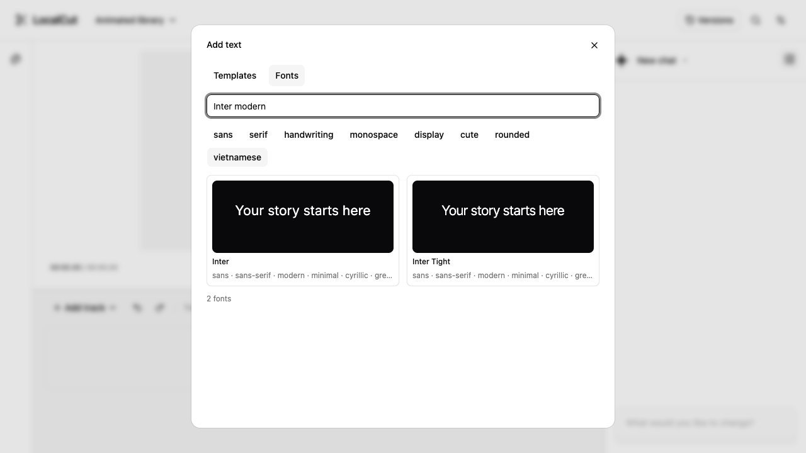

# LocalCut

A browser video editor with local media processing and an optional AI editing assistant. Import your own media, edit a timeline, and export a video without creating an account or running a backend.

[Try LocalCut](https://wilsonle.github.io/LocalCut/) · [Get started](docs/getting-started.md) · [Contribute](CONTRIBUTING.md) · [Documentation](docs/README.md) · [Changelog](CHANGELOG.md) · [Get help](SUPPORT.md)

## What you can do

- Import video, audio and images; record a screen, window or browser tab through the browser's source picker.
- Arrange tracks, trim and group clips, separate audio, adjust speed and pitch, and edit transitions.
- Add styled and animated text, use bundled fonts, and generate captions with explicitly prepared local Whisper transcription.
- Review AI editing proposals before applying them. Optional OpenRouter, compatible endpoints and ChatGPT connections support configured service routes; speech generation uses an explicit Generate action.
- Export MP4/H.264/AAC or WebM/VP9/Opus when your browser supports the required codecs.
- Save projects and versions in this browser and export portable project/workspace backups with optional original media.

The application builds to static files. Headless consumers discover content-hashed editor and AI modules through `modules.json`, following [the API recipe](docs/api.md). Stable `editor.js` and `ai.js` compatibility aliases remain available. This repository is an application, not a published npm package (`private: true`).

## Browser support and data

Use current stable desktop **Google Chrome** for the complete supported experience; Safari has focused macOS regression coverage. Export and capture capabilities vary by browser/device. See [browser support](docs/browser-support.md).

Projects stay in this browser with no cloud sync; export backups with originals. Read [privacy and data flows](docs/privacy.md) before connecting optional AI providers.

## Your first edit

1. Open the app, create a project or open one saved in this browser, and import your media.
2. Select clips and edit the timeline or Clip properties. Preview, Undo and Redo use the same editing engine as export.
3. Optionally connect a provider in Chat, describe an edit and review the proposed operations. Choose Apply or Discard.
4. Open **Settings → Export**, choose an available format, export, then Save video.
5. Use **Settings → Project → Export project** or **Settings → Workspace → Export workspace** for a backup; select original assets if the backup must stand alone.

See the [first-edit guide](docs/getting-started.md) for versions, provider setup and backup recovery.

## Setup

Use **Node 24 LTS** and **pnpm 11.25.0**. Follow the [setup guide](docs/setup.md) to clone, install and start LocalCut locally.

Contributors: read [CONTRIBUTING.md](CONTRIBUTING.md), then the [development guide](docs/development.md) for commands and focused checks. Coding agents also follow [AGENTS.md](AGENTS.md).

## Versioning

LocalCut is currently **v0.1.0-alpha.1**, an unreleased alpha in initial development. Named releases follow [SemVer](https://semver.org/spec/v2.0.0.html) using the [project release policy](docs/releasing.md#semantic-versioning). Read the [short changelog](CHANGELOG.md) for user-facing outcomes and links to each version's full Git diff. Development deployments are identified by commit; no release tag has been published yet.

## Contributing and community

Bug reports, documentation fixes, accessibility improvements, reproducible browser checks and focused feature proposals are welcome. Start with [CONTRIBUTING.md](CONTRIBUTING.md), use the [issue templates](https://github.com/WilsonLe/LocalCut/issues/new/choose), and follow the [Code of Conduct](CODE_OF_CONDUCT.md). For questions use [SUPPORT.md](SUPPORT.md); for suspected vulnerabilities use [SECURITY.md](SECURITY.md).

The [roadmap](docs/roadmap.md) explains current priorities and how to propose work. [Governance](docs/governance.md) describes maintainer decisions, and the [maintainer guide](docs/maintaining.md) covers triage, reviews and releases. There is no promised support response time or release schedule.

## License

LocalCut's original code and documentation are available under the [MIT License](LICENSE). Dependencies, fonts, model assets and test fixtures retain their own licenses and attribution; see [THIRD_PARTY_NOTICES.md](THIRD_PARTY_NOTICES.md). Keep those notices and the per-family font licenses when distributing builds.
