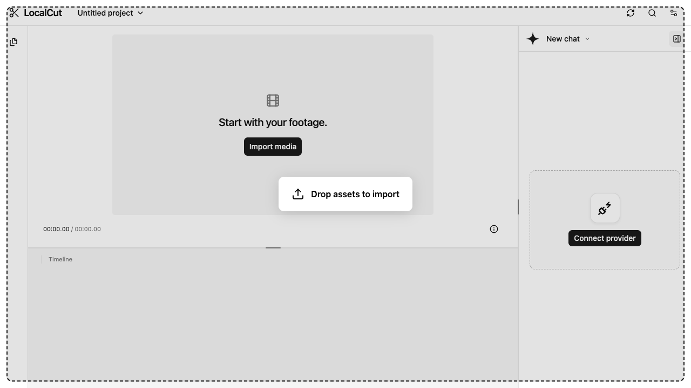
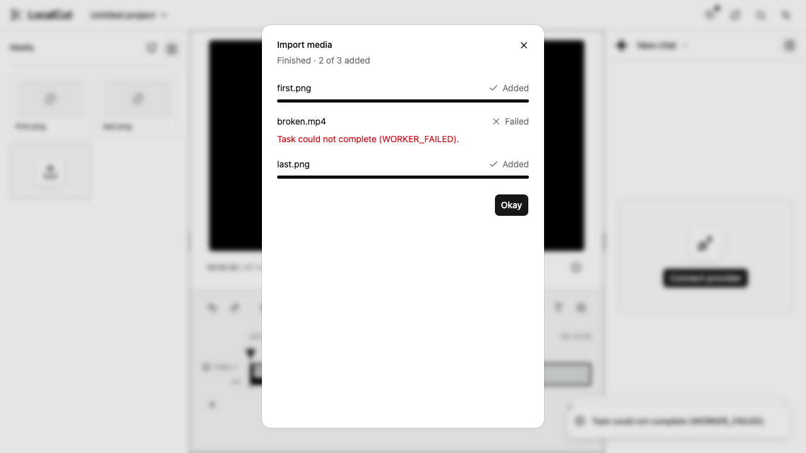
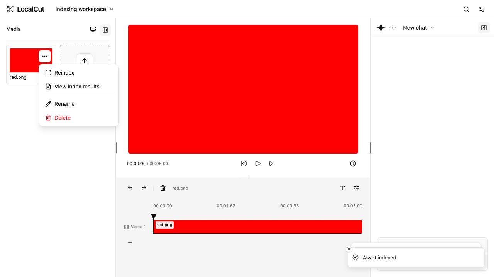
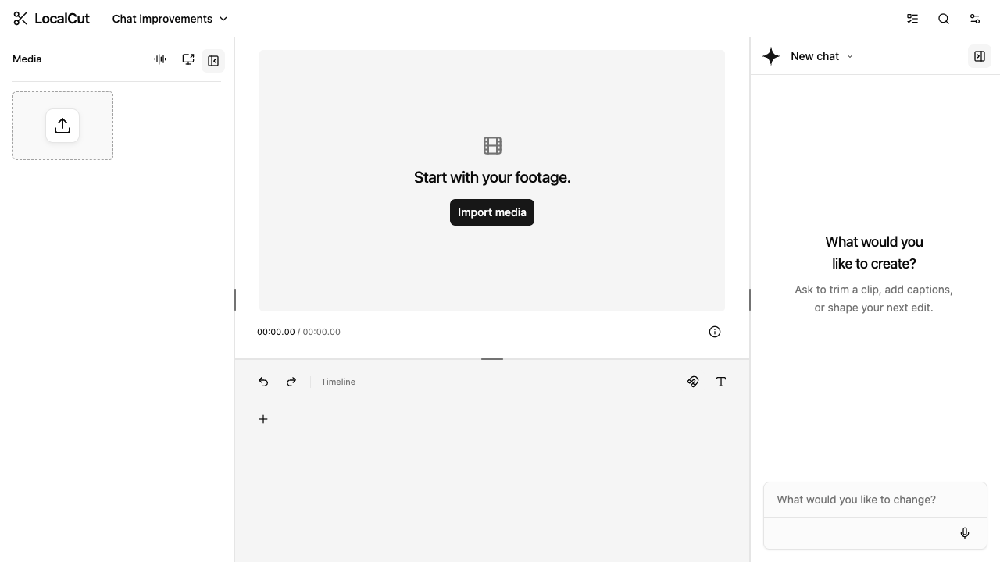

# Workspace

The interface follows the approved conversation-led mockup: independently collapsible media on the left, preview and compact timeline in the center, and resizable conversation on the right. Mobile shows the active Edit, Chat or Media view. Production contains no illustrative clips, simulated replies or fake export progress.

Desktop chat, editor and media share shadcn Resizable panels; a vertical divider adjusts the preview/timeline split. Pointer dragging applies geometry immediately, while keyboard arrows move 16 pixels (Shift moves 64); Home/End select the available bounds. Deliberate chat/media widths and timeline height save when a drag finishes and travel with workspace preferences. Responsive constraints never replace the preferred size. Narrow screens start on Edit and retain each mounted view while switching tabs.

The app stays within the viewport; panels and the selected mobile view scroll internally. Dialogs have a stable height of up to 40 rem, capped at the scaled viewport height minus 2 rem. Overflow scrolls inside the dialog, or its dedicated content area for AI settings, clip properties and Commands. Popup scroll boundaries contain wheel and touch scrolling so they cannot move the enclosing dialog or workspace; scrollbars remain hidden.

The narrower chat can collapse into a rail while the editor expands, and returns with its conversation intact. Both regions animate together and respect reduced motion. Settings → AI settings opens the existing AI provider/service/model connection dialog directly. The composer has no information button or intermediate provider popover. Check for update, Commands/search and Settings sit in the right action group, before the project-view tabs. The header settings menu reveals Project, Workspace, View and Export groups progressively and includes Appearance; media sits on the left and stays reachable from its edge toggle, with chat on the right. Supporting metadata lives in tooltips and disclosures. Durable design choices are recorded in [user preferences](user-preferences.md).

Chat follows the CYOBot instructor workspace's interaction structure: session picker, scrolling transcript, right-aligned user bubbles, plain assistant replies, tool disclosures, action receipts, and a growing composer using the same corner radius as other controls. Tool disclosures expose each call's complete permitted input, result or error separately, subject to the same sharing policy as its remote context. Skill-loading activity is labelled Load skills; each row includes its skill name and actual status, such as Load skills: Indexing · Completed. See the [mobile skill disclosure](images/chat-skill-load-mobile.png). The composer retains typed and dictated text and all explicitly attached images without application size/count ceilings; provider capacity still applies. Enter sends; Shift+Enter inserts a newline. IME composition and repeated Enter do not submit. Stop cancels the active turn, and scrolling up reveals a return-to-latest control. The header session picker searches chat titles, reuses an unused chat or creates one when every chat has messages or a draft, and restores each chat’s transcript and unsent draft. Switching is disabled while a response or requested operation is running. Sessions persist locally in a separate IndexedDB sidecar for the current project, configured LLM route/model and sharing policy. Returning to that context restores its selected chat, transcript and draft across reloads. Chat resizing is available above 900px; narrower layouts use a fixed responsive width.

The first submitted message immediately supplies a local title fallback and asynchronously requests a concise name through the chat's configured model/routes. The completed name replaces the fallback in the header, searchable picker and chat commands. Naming does not disable switching or delay replies. It runs once per fresh chat; later messages, Resume and branch chats preserve their title. Switching or collapsing may let naming finish for the original retained chat. Changing connection/project/model/sharing scope retires the request. Failure keeps the fallback without a retry. Within the same session, outgoing text fades upward and blurs while the replacement fades in from below over 420 ms; reduced motion replaces immediately, and switching sessions does not replay the effect. Titles persist with their chat. Manual renaming locks the chosen name against later automatic naming.

## Application updates

The header update icon checks on explicit click, with pending feedback and retryable errors. It reads fresh `build-info.json` from the current static host and prompts only when the running commit is an ancestor of a different deployed commit. Same, older and unrelated deployments do not prompt. Update now uses the existing cache-busting reload, retaining the project URL and saved browser data; Later keeps the current session. Finish active work first: unfinished responses stop on reload, while saved chats and drafts restore locally. Metadata-free builds cannot establish an update. This application lifecycle action is user-owned, outside assistant editing proposals.

## Project navigation

Select the project name in the desktop or mobile editor header to open the Projects dialog over the mounted editor; the name has no chevron. Escape, Close or selecting the Current project dismisses it without changing the URL or editing state. Selecting another project closes it and navigates to that project. The LocalCut logo is static branding. Settings → Project → Open project and Mod+O open the Projects screen. Editor and Storyboard tabs sit at the far right of the project header, after the global actions, with left-aligned contents. Search saved names, then select a project to open it in the editor. Projects are sorted by name and show clip count and timeline duration; the active project is marked Current. New project and Import backup reuse the existing flows. Workspace/project ZIP imports remain available through settings and Commands.

Back to editor or selecting the Current project preserves the current selection, playhead, version preview and conversation. Browsing pauses playback and hides the mounted editor from keyboard/accessibility interaction. Opening another project flushes the current project's pending version, resets selection/playhead and clears any previous video download. Project events refresh the list across windows; Refresh projects retries failed loads and picks up saved changes. Bare page navigation remains inert: project storage and editing services initialize after an explicit create/open/import or browse action, or a valid project/catalog route. This screen does not delete, rename or migrate projects.

The workspace shell and project browser render with the initial UI rather than waiting for a separate workspace chunk. A local display cache immediately supplies project names, clip counts and durations on return/reload; storage refresh replaces those summaries without clearing the list or its search. Cached rows remain usable during catalog refresh. Selecting one reads the current project from storage, so removed projects fail through the existing recovery flow instead of opening cached documents. Uncached lists, editor panels and project opening use themed skeletons that respect reduced motion. See the [workspace skeleton](screenshots/loading-workspace-skeleton.png), [cold project list](screenshots/loading-projects-skeleton.png) and [cached mobile list during refresh](screenshots/loading-cached-projects-mobile.png).

## Project creation

The New project dialog offers aspect-ratio and resolution presets, editable pixel dimensions and a frame-rate selector, defaulting to 1920 × 1080 at 30 fps. Resolution tiers use the shorter side (height for landscape, width for portrait). Only presets within the existing 3840-pixel width and 2160-pixel height limits appear. Manual dimensions show matching presets or Custom; fractional frame rates retain their exact rational values in the project. These settings belong to each project and survive reopening. Cancelling the dialog discards its unsaved choices. See the [desktop creation controls](screenshots/project-format.png) and [mobile dialog](screenshots/project-format-mobile.png).

## Local user preferences

The browser remembers preferred chat width, whether chat is collapsed, deliberate media-panel visibility, timeline snapping, export format, and the last selected primary AI model and non-secret named provider/service routes, alongside the existing appearance choices. These choices apply before the workspace renders, without opening a project or starting editing/AI services. Root and `/LocalCut/` share preferences on the same origin, and workspace choices synchronize across tabs. Changing preferences never changes project content or exported media.

Chat width is saved in pixels between 280 and 560. Dragging or keyboard resizing updates the preference; dragging below the midpoint between the expanded minimum and 52 px rail snaps a sidebar closed (166 px for chat and 151 px for media on a wide desktop). Collapse saves visibility while preserving its expanded width; edge buttons restore it. Collapse, constrained desktop/narrow screens and Appearance's temporary space constraints do not replace it with the rendered width. Expanding chat or returning to a wide layout restores the preferred width. The media toggle, View menu and keyboard shortcut save deliberate visibility changes. Importing files may temporarily reveal media without changing that saved choice; a later synchronized visibility change takes precedence. Export's menu and dialog share the remembered container, while codec checks still run for each actual export.

The model preference stores an identifier only. Reload restores a saved credential; Disconnect removes it and requires a new connection; after connecting, the preferred model is selected only if it is in the current tool-capable catalog. If unavailable, choose a model explicitly; no substitute is selected and the old preference remains available for a later reconnect. Tab synchronization does not change an active conversation's model. No paid request begins just because a model was restored. Credentials are excluded from preferences and backups; ChatGPT OAuth tokens have a separate saved record restored explicitly. Context authorization is never a preference: actual connected OpenRouter accounts enable all four categories under the visible connection terms, including after reload; disconnecting the last account removes the grant.

Invalid or unknown preference records use safe defaults, with finite widths clamped to supported bounds. Blocked/full storage leaves controls usable for the session and reports a toast with a recovery step. A later successful change retries saving the session choices. Appearance Reset affects appearance only, preserving workspace preferences, projects and other applications' storage.

The audit covers the workspace, conversation/session picker, preview/timeline, dialogs, settings, appearance and shared UI controls:

| State                                                                                                                         | Decision                    | Reason                                                             |
| ----------------------------------------------------------------------------------------------------------------------------- | --------------------------- | ------------------------------------------------------------------ |
| Appearance choices, including interface size                                                                                  | Persist (existing)          | Durable visual customization                                       |
| Chat width and collapsed state                                                                                                | Persist                     | Deliberate workspace layout                                        |
| Media visibility                                                                                                              | Persist deliberate toggles  | Import-driven opening remains temporary                            |
| Timeline snapping                                                                                                             | Persist                     | Deliberate pointer-seeking choice                                  |
| MP4/WebM export format                                                                                                        | Persist                     | Repeated export choice; never skips capability checks              |
| OpenRouter model ID                                                                                                           | Persist                     | Repeated provider choice, validated after connection               |
| OpenRouter credential                                                                                                         | Separate local record       | Restore connection after refresh; exclude from backups             |
| OAuth state                                                                                                                   | Session only                | Temporary PKCE state                                               |
| OpenRouter context authorization                                                                                              | Derived from connection     | All four categories under visible connection terms                 |
| Projects, assets, versions, clip properties, history, transcripts                                                             | Existing project storage    | Authored content has its own canonical owner and backup contract   |
| Active clip, playhead, playback, historical version                                                                           | Session only                | Transient editing view; explicit project identity lives in the URL |
| Conversations, drafts, titles, historical tool disclosures                                                                    | Separate local chat sidecar | Local workspace content, excluded from portable backups            |
| Executable proposals, approvals, loaded skills                                                                                | Runtime only                | Operation authority is never restored                              |
| Search, scroll/follow-latest, session-picker disclosure, tooltip/menu/popover/model-picker/dialog/Appearance-panel visibility | Session only                | Temporary navigation and focus state                               |
| Jobs, loading, errors, progress, rendered layout bounds, resource handles                                                     | Runtime only                | Derived or disposable state                                        |
| Project defaults, provider identity, shortcuts, codec/inference settings                                                      | Existing fixed contracts    | No configurable user choice currently exists                       |

## Appearance

Open **Workspace settings → Appearance** to customize the running app. The panel sits beside the editor on wide screens and above it on narrower screens; the editor remains usable as the preview. While the panel is open, chat can render narrower to retain preview space alongside expanded media; closing Appearance restores the preferred chat width. Phone layouts show appearance controls above the selected workspace view, with the other mobile tabs available from the bottom navigation. Changes apply immediately to app colors, menus, dialogs, typography and corners without reopening the project or conversation.

Inspired by [shadcn Create](https://ui.shadcn.com/create), the panel offers light/dark/system mode, neutral base color, accent theme, body and heading fonts, radius, density, menu color and menu accent. Both font menus offer the complete text-editor catalog: 1,787 bundled families and ten legacy styles, alongside the eight additional named local stacks. Search font names and style/language tags to reach all choices; headings can also follow the body font. Selected bundled families load from the application origin with verified checksums, including all Unicode subsets for future interface text. Font files and the full catalog stay lazy on default startup; saved bundled choices restore without opening editing services. Loading failures retain the selection and offer Retry fonts. Base UI and Lucide remain fixed. Density changes preview/timeline spacing. Theme colors also adapt timeline clips while audio and text retain distinct semantic tints. Video content and exported media are unaffected.

Choices save automatically in this browser and synchronize across tabs on the same origin. They apply before the workspace renders; System follows the device color scheme. Randomize changes appearance options while retaining the chosen mode and interface size. Reset restores LocalCut's light, neutral, system-sans defaults and removes only its appearance record. If browser storage is blocked or full, changes remain usable for the current session and the panel reports that they could not be saved. Unsupported or malformed records fall back to safe defaults.

Interface size offers Default (100%), Small (75%) and Large (125%) with an immediate preview. It scales controls, menus and dialogs together, without changing project geometry or export resolution. The desktop timeline fills to the editor bottom; shorter viewports scroll inside the editor and narrow layouts show only the selected workspace tab at the selected size. Playback controls wrap when side panels leave a narrower preview. See the [Default](screenshots/interface-default.png), [Small](screenshots/interface-small.png) and [Large](screenshots/interface-large.png) desktop layouts. Older saved appearance and portable backups default to 100%. Size survives reload and tab synchronization; Randomize retains it and Reset returns it to Default. Page zoom shortcuts and gestures are intercepted, but a web page cannot reset or lock browser-menu or saved site zoom; use the browser's 100% setting for the nominal sizes.

Close the panel or press Escape to return focus to Workspace settings. An open picker handles Escape first. No account, editor initialization or remote request is needed to customize appearance.

## Projects and media

Creating or opening a project explicitly initializes the existing engine. Bare initial navigation without a saved recent project does not open IndexedDB, start workers, request permissions or download models. The Projects screen lists projects in this browser. React Router hash routes identify the current saved project as `#/project/<id>` and the project catalog as `#/projects`. The catalog URL includes `?project=<id>` when returning to the current editor is possible. Creating, opening or importing a project updates the URL. Reload or a direct project link restores that local project and its committed edits; Back/Forward selects the screen and project recorded in history. These routes work at both `/` and `/LocalCut/` without server rewrites. Project links refer to this browser's local storage, not shared cloud projects.

The bare app URL reopens the most recently successfully opened project in this browser and replaces the URL with its project route. Explicit project/catalog/invalid URLs take precedence. OAuth callback startup defers recent-project restoration to the authentication owner, which restores its saved return route after verification. Later Back/Forward follows history without a fallback. A missing remembered project clears its matching pointer and shows recovery; storage failures retain it for Retry. With no valid remembered identity, startup stays inert. Explicit project/catalog URLs and remembered startup may initialize local editing; they never create a missing project, download models or start paid AI. Loading blocks stale editing, with accessible progress; missing/deleted projects and invalid addresses show recovery to saved projects, and storage failures offer Retry. Navigation waits for a running authored operation and ignores superseded loads. Routed project restoration also restores chat readiness when its separately saved credential/model is available; OpenRouter context sharing remains enabled under its connection terms.

Import media accepts the supported video, audio and image formats described in the engine API. Each successful file import is appended to its matching track through an atomic command batch. Images begin with five seconds; video and audio use their measured source duration. Images/video are fitted inside the project dimensions without changing their aspect ratio. Files that fail validation do not create clips; files already committed earlier in the same selection remain available.

Drop local files anywhere over the app, including the Media tab. An app-wide indicator appears while files hover over an available workspace. Text, links and internal timeline drags retain their existing behavior. Busy operations, dialogs, unavailable project routes and historical versions reject file drops without navigating away. An explicit drop can create the first project; hovering does not initialize editing. On mobile, dropping reveals Media without changing desktop layout preferences.

Picker selections and drops share an import progress dialog with one row per file, measured job progress, and queued, importing, added, failed or cancelled results. Invalid files retain their error and do not stop the rest of the batch. All selected files are submitted to the durable task queue before waiting for results. Okay and the top-right X are the only buttons; either dismisses the informational dialog while imports continue, as does Escape. Dismissal permits editing and project navigation and keeps background completion from changing the current selection or panel visibility; files are still placed in selection order in the initiating project against fresh revisions. The dialog stays open after completion until dismissed; a new batch starts a new summary, and old background batches cannot overwrite it. Task queue retains per-task cancellation; cancelling one file does not cancel the other queued files. Original files remain local. Progress before measurement is indeterminate, and import progress describes inspection/storage rather than a remote upload.

The media panel arranges the independent local library left-to-right, top-to-bottom, followed by an outlined upload-icon shadcn Empty import card as the last grid item; its tinted surface, stronger dashed border and raised icon tile distinguish it from media thumbnails, and its whole surface opens the file chooser. Screen recording sits beside the Media title, with a horizontal divider beneath the header. Backup remains in Settings → Project → Download project backup. Each media card has a top-right actions menu revealed on hover or keyboard focus and always visible on touch devices. It contains Rename, Move to, Copy to, Delete, Download and Relink for missing sources. Library names and folder operations use the separate library revision. Delete moves library entries into recoverable Trash and preserves timeline clips, originals and saved index runs. See [Media folders](#media-folders) for navigation and recovery. Browsed versions disable edits. Settings → Project → Export project and Import project provide a scoped transfer dialog with optional saved versions and individual original-asset checkboxes. Workspace Export/Import uses the same flow for all saved projects, including closed projects, plus separate appearance and workspace preference groups. Select or clear projects, versions and originals independently. Project import chooses one project when inspecting a multi-project archive. Exports without source files are JSON; selecting originals produces ZIP. Missing or omitted originals require relinking. The dialog previews contents before importing new copies and leaves the active editing session intact.

Legacy Download project backup / Import project backup controls retain the original JSON-only format; version-one project envelopes also work in the new project import dialog. Archives exclude keys, sharing consent, conversations, receipts, undo/redo, caches and unrelated origin storage. Import never reconnects AI or starts paid requests. Complete settings groups replace only their corresponding saved preferences. Settings-only import keeps editing services inert. Imported projects commit together; settings persistence failures retain those copies, report an error and permit a settings-only retry. Cancellation is available while reading/packing/restoring; published copies survive late cancellation. The [storage contract](storage.md#workspace-and-project-transfer) describes validation and resource limits.

### Screen recording

Use **Media → Record screen → Choose source and record** to create media from a screen, app window or browser tab offered by the browser's sharing picker. Capture requires a supported desktop browser on HTTPS or localhost and explicit permission for each recording. App capture uses the selected app window; available surfaces and system permission prompts depend on the browser and OS. Opening the dialog alone requests no permission and starts no editing services.

**Include shared audio** is off initially. Enable it before choosing the source, then enable the picker's audio option where offered. LocalCut requests system audio for screen and window capture, but the browser and OS decide whether to supply it. If no live audio track is returned, recording does not start: the dialog explains how to retry, or you can turn the option off for video-only capture. If shared audio ends during recording, LocalCut stops immediately and preserves the recorded portion for review; the dialog explains why it stopped. This also preserves the take when a browser ends audio before video after Stop sharing or source closure. The live preview stays muted to prevent feedback; this does not mute the recorded sound. When shared audio is enabled, the dialog shows browser-specific guidance before source selection. Safari and Firefox do not provide shared tab/system audio through this API: turn off shared audio for a silent recording, or open both LocalCut and the target page in Chrome or Edge and share that browser tab with audio enabled. Chromium browsers recommend tab audio and explain that screen/window sound depends on the browser and OS; unrecognized browsers receive cautious support and fallback guidance. Browser identification selects helper text only; actual returned tracks still determine whether recording can start. Newer Chrome versions can also offer system audio for screens/windows where supported; check macOS Screen & System Audio Recording permissions if access is denied. LocalCut cannot add audio that the browser did not capture. Microphone capture is not requested. Use **Stop recording**, or the browser's Stop sharing control, to finish and review the playable recording. **Add to media** imports it through the ordinary local import/timeline workflow, creating an untitled project if needed. **Save a copy** downloads the recording before import or after an import failure. Imported recordings support editing, history, persistence and export like other video sources.

Discard, Escape, close and project navigation release capture and discard unfinished media, including permission granted after dismissal. No capture is requested on startup, no permission is remembered by LocalCut, and recordings are never uploaded. Recording is unavailable in historical versions. Capture metadata and completed recordings are retained in the task sidecar; cancelled captures retain only their status. Capture never initializes project storage before Add to timeline. Buffers remain transient until the queue saves a completed take: capture stops automatically at 30 minutes or near 256 MiB; exceeding that byte cap fails explicitly. Long recordings should be split into separate takes. Source dimensions are retained; timeline fitting uses the existing project settings. See the [live desktop preview](images/screen-recording-live.png) and [narrow review dialog](images/screen-recording-narrow.png).

## Editing and preview

Select a timeline clip to open its properties, split at the playhead or delete it. Start and duration use seconds in the form and integer microseconds in the engine. Changing only speed preserves the existing source range and changes duration. Clip properties offers Change pitch/Keep pitch and a Speed profile selector. Choose a constant rate or up/down/up-then-down/down-then-up preset; edit point percentages and rates, add/remove interior points, and choose Curve, Linear or Staircase for each segment. Dedicated staircase presets start with eight editable plateaus and reach their last speed before the endpoint. The graph shows the current profile. Editing duration explicitly changes the source out-point; the engine rejects unavailable source time and invalid keyframe/caption/fade bounds. Undo and Redo use the canonical history and revision checks, including after reload.

Manual changes retain the revision shown in the workspace. If another window commits first, LocalCut rejects the stale change and refreshes the form. Review the latest values before retrying; concurrent edits are not silently overwritten.

The timeline text icon (Add text) opens a searchable library with Templates and Fonts views. Search names or labels such as cute, minimal, curved, shadowed and highlighted; select a card to create an editable three-second overlay at the playhead. Templates include placeholder text, font and formatting. The properties form exposes timing, text, a searchable font picker, size, alignment, bold/italic, spacing, curve, colors, outlines and shadow settings, with a live sample. Apply properties saves these through the engine; Undo/Redo, versions, reload and JSON backups retain them. The font library adds 1,787 bundled open-source families to the ten legacy system stacks. Search names and style/language tags in either picker; the gallery provides tag filters and pages of 24 samples. Font files load from the application origin only when visible or needed for rendering, with checksums and visible failures. Bold and italic on bundled faces use browser synthesis of the bundled upright face. Animated templates include typewriter reveals and looping three/four/five-frame handmade poses, with editable step timing, looping and optional text variations in Animation settings. Incomplete animation settings show a stable sample until valid, and cycling text can use variations with an empty main text field. Gallery cards retain their names and tags while scrolling on narrow screens. Samples animate only while visible and respect reduced motion; worker preview and native exports evaluate deterministic clip-local timing. Workspace appearance shares this catalog but retains independent font selections. Advanced effects and transitions are available through assistant proposals and the documented engine API. Local transcription and export can also be proposed by the assistant, with explicit approval before any job starts.

See the [text library](images/text-library.png) and [narrow text library](images/text-library-narrow.png). Gallery samples, preview and export share the same text drawing function.

Preview uses the same engine compositor as export. First-frame and last-frame buttons flank previous-frame, Play/Pause and next-frame controls in one row. They pause playback and seek through the same preview owner. Preview frame controls round their positions to integer microseconds, including the final-frame clamp at rational frame rates, so Play can resume after stepping. Playback creates its audio context only from the Play action. Scrubbing supersedes pending frames; project changes stop the old playback session. Disposal releases image bitmaps, sessions, audio contexts and active jobs. No media is sent to a server.

In Media, Cmd+A / Ctrl+A selects all visible assets in the current folder. Click selects one asset; Cmd-click / Ctrl-click toggles individual assets; Escape clears the selection. Moving to another folder clears media selection. Text fields retain native select-all, and the focused timeline retains clip select-all.

Seek by dragging the top marker of the playhead with a mouse or touch. Its padded target sits above the tracks so clip selection remains available. The timeline has no separate bottom scrub bar. Focus the marker to use the shared playback shortcuts, including frame steps and Home/End. See the [mobile](images/timeline-playhead-mobile.png) and [desktop](images/timeline-playhead-desktop.png) layouts.

Drag a ready media card onto an audio track for audio, or a video track for images/video. A compact thumbnail or media icon with the asset name follows eight viewport pixels from the cursor throughout the app while dragging, flipping to the other side near viewport edges. A dashed clip placeholder also shows the name, start time and full duration over a compatible track; moving off the lane clears only that placement placeholder. Release or cancellation clears the cursor preview. Dropping inserts another clip from the same local source through the shared engine, preserving existing clips and Undo/Redo. Images use the same five-second default as import. The timeline retains its time scale while hovering; long placeholders extend into horizontal scrolling. Missing sources, busy operations and historical versions cannot be dropped.

Drag a timeline clip to reposition it within its track or onto another compatible, unlocked track. A dashed placeholder shows the destination before release. The grabbed point stays under the pointer at different zoom and interface sizes. Snapping aligns either clip edge to nearby boundaries; its enabled/disabled icons differ. Group members move by the same time offset, with the grabbed member changing tracks. Click selection and end resizing stay separate; Escape, pointer cancellation or a project/version change cancels movement. Placement uses the shared revision-aware command/history path and persists locally. See the [desktop](images/timeline-clip-move-desktop.png) and [mobile](images/timeline-clip-move-mobile.png) placement previews.

Drag a track label to reorder the whole row. Its label and clips follow the pointer while neighboring tracks animate around the dashed destination placeholder. Release commits the order; Escape or pointer cancellation restores it. Reduced motion removes the rearrangement animation. Alt+Up/Down retains keyboard reordering.

Drag the right edge of a clip to shorten or extend its duration. The temporary edge and duration label preview the edit; release saves it and Escape cancels. Images and text keep their authored content for the new duration. Audio/video retain their selected source range and repeat from its beginning when extended beyond that range; dashed boundaries and a repeat icon identify loop-backs. The same loops play in preview and exports. Focus the edge to adjust by one frame with Left/Right, or ten frames with Shift. Undo/Redo, splitting, speed changes and local project reloads retain looping.

See the [media drop preview](images/timeline-media-drag.png), [track reorder preview](images/timeline-track-reorder.png) and [clip loop markers](images/timeline-clip-loop.png).

## Keyboard editing

Focus the preview or timeline to use single-key shortcuts. `Space` toggles playback; `K` pauses and `L` plays forward. Left/right arrows step one frame, Shift+left/right step ten frames, up/down visit previous/next edit boundaries, and Home/End seek to the first/last frame.

| Action                                          | Shortcut or gesture                                           |
| ----------------------------------------------- | ------------------------------------------------------------- |
| Save a project version                          | Mod+S                                                         |
| Split at playhead                               | S or Mod+B                                                    |
| Duplicate selection                             | D or Mod+D                                                    |
| Select all / clear selection                    | Mod+A / Escape (clips or focused Media)                       |
| Copy / cut / paste clips at playhead            | Mod+C / Mod+X / Mod+V                                         |
| Add/remove selection, including group members   | Shift/Mod+click                                               |
| Group / ungroup                                 | Mod+G / Mod+Shift+G                                           |
| Nudge selection one / ten frames                | Alt+left/right / Alt+Shift+left/right                         |
| Trim start / end to playhead                    | Q / W                                                         |
| Delete / safe ripple delete                     | Delete or Backspace / Shift+Delete                            |
| Properties                                      | Enter on focused clip or double-click clip                    |
| Open text library                               | T                                                             |
| Zoom pointed timeline or preview                | Ctrl/Command+wheel or trackpad pinch                          |
| Zoom focused view / fit                         | + or = / − / 0 or backslash                                   |
| Pan                                             | Middle-button drag; Shift+wheel scrolls timeline horizontally |
| Seek / scrub                                    | Drag playhead; click empty lane or click/drag ruler           |
| Fit preview                                     | Double-click preview                                          |
| New project / toggle chat / toggle media / help | N / C / M / ?                                                 |

Zoom and pan are transient views, independent between timeline and preview; they never change project geometry or exports. Keyboard zoom targets the focused view, falling back to the timeline when the editing area has focus. Timeline zoom ranges from fit to 32×; preview from fit to 8×. Normal wheel/trackpad scrolling remains native; page-delivered Ctrl/Command zoom shortcuts and wheel/pinch gestures are intercepted throughout the app. Timeline/preview view zoom remains independent; browser-menu zoom and OS accessibility controls retain their own authority. `?` and Workspace settings → Keyboard shortcuts list the complete map. These mappings follow common [desktop editing conventions](https://helpx.adobe.com/sg/premiere/desktop/get-started/keyboard-shortcuts/default-keyboard-shortcuts.html), adapted to the supported LocalCut commands.

The local clipboard holds a frozen clip selection only within the current session and project, including group membership, keyframes, captions and transitions between copied clips. Paste makes new identities, keeps relative track/time placement and uses current originals; it does not access the system clipboard. Cut changes the clipboard only after its removal succeeds. Source files and text-field copy/paste retain their existing workflows.

Nudging preserves group offsets and clamps the earliest member at zero. Q/W shorten one ungrouped clip with the engine's split semantics, preserving animation, fades and source bounds; select a point inside the clip. Ripple delete closes the selected time interval on every track only when no retained clip intersects it and no retained group straddles it. Unsafe ripple/trim commands are unavailable. Engine validation still rejects invalid transitions or timing atomically. Normal Delete leaves the gap. All edits are undoable and preserve revision conflict handling. Holding an editing key does not repeat mutations; frame navigation and zoom may repeat.

The pass covers existing LocalCut workflows. Source-monitor insert/overwrite, markers, dedicated slip/slide/roll tools and reverse/rate shuttle have no supported workflow/API and receive no misleading bindings. Historical versions allow selection, navigation, properties and view gestures; mutation and clipboard shortcuts remain unavailable.

Dialog opening shows cancellable feedback immediately while optional UI code loads, then a modal loading shell and the requested controls. Escape or Cancel dismisses opening feedback; close/Escape also dismisses a loading shell. Completing a dismissed download never reopens it. Loaded dialogs reuse their code on reopening and retain normal focus return and reduced-motion behavior. Simple forms do not load the text library or clip-properties editor. Commands downloads its metadata and palette together and shows command controls only when both are ready.

Mod+K opens Commands from outside text fields and dialogs. The header search icon and Workspace settings → Commands also open it. Search project, media, editing, clip selection, playback, version, export, view, appearance and chat operations; use arrows and Enter to run an available action. File, property, export and AI configuration commands open their existing workflows. AI proposals still require explicit approval. Unavailable actions are omitted, including mutations and export in a historical version. Escape dismisses the palette and returns focus to its header control.

See the [desktop palette](images/workspace-commands.png) and [narrow palette](images/workspace-commands-narrow.png).

Command on macOS or Ctrl elsewhere works with `Z` for Undo, Shift+`Z` for Redo, `O` for Open project, `I` for Import media, and `E` for Export. Ctrl+`Y` also redoes. Shortcuts never intercept text inputs, IME composition, dialogs or menus; Space on a focused button retains its native action. Editing shortcuts call the same revision-aware operations as the visible controls.

Pointer seeking snaps to the nearest clip start/end across every track, including audio, text/captions and overlapping clips, within eight screen pixels. Project edges also attract the playhead; the final position remains inside the half-open playback range. The magnet button in the timeline toolbar toggles **Snapping**, starts on and remembers the choice locally, across tabs and in workspace backups. Older settings/backups default on. Zoom, scroll and interface size preserve the screen-distance threshold. Keyboard frame stepping and playback retain their existing precision.

Direct edits show their result in the timeline and preview without a success toast, including split/delete, properties, history, track changes, grouping, audio separation, transitions and assistant edits. Errors, background completions and actions without apparent feedback still use notifications.

## Version browsing

The workspace omits unavailable editing, media and playback buttons; Versions and video export live in Settings → Project → Versions and Settings → Export → Export video, respectively, with unavailable actions omitted; the header omits their standalone buttons, the duplicate New project button and local-storage information icon. Create projects through the Projects screen, Workspace settings → Project → New project or Commands. Scrollbars are hidden throughout the workspace and popup surfaces; wheel, touch, trackpad and keyboard scrolling remain available.

Settings → Project → Versions opens the saved history and checkpoints pending edits. Select a version to recreate its full timeline, project dimensions, media references and preview. You can select clips, inspect read-only properties, scrub and play the saved state. Editing controls, imports, relinking and export are hidden while browsing; AI requests/application remain blocked. The conversation stays mounted and refers to the current project; transient chat and playhead state are not part of the saved project document.

Return to current resumes the latest project, including changes from another tab. Restore as new version copies the selected state into a new current revision and appends a new version; earlier and later historical entries stay unchanged. If another tab changes the current revision before restoration, review its latest state and retry. Undo can reverse the restoration without deleting the restored version. Closing history returns to the current project.

Autosave appends a version one second after the last committed edit. Rapid edits form one settled version; Undo/Redo also autosave. Pending work is checkpointed when switching projects, browsing history or closing the editor. A forced tab close still retains committed edits; reopening checkpoints the recovered current state. Version history is local to this browser and project; legacy project JSON carries current state only. The new workspace/project transfer dialog can include the version list and historical originals.

## Optional AI

Dialogs fit their content up to a shared 48rem/viewport height cap, including mobile safe areas and the selected interface scale. Short forms, confirmations, empty queues and import/export progress stay compact. Rich text, speech, recording and backup editors use wider desktop layouts; Projects retains a stable 40rem/viewport browsing height. Overflow scrolls within the dialog or its existing content region. See the [compact rename dialog](images/dialog-sizing-rename.png) and [speech editor](images/workspace-voice-presets.png).

AI settings remains a spacious, scrollable dialog: a wider desktop layout and more spacing give provider configuration room, while narrow screens retain a viewport-bounded dialog. The title, close control and footer stay visible while configuration scrolls. Shared shadcn Base UI Accordion and Collapsible disclosures animate height and indicators, preserve form values and keyboard interaction, and respect reduced motion.

Connect AI accepts a user-owned OpenRouter key or starts its PKCE login. Provider connections is collapsible and adds named OpenRouter accounts, OpenAI-compatible endpoints or ChatGPT accounts. Multiple accounts of the same provider keep separate credentials and routes. Connected accounts offer Verify, Disconnect and Remove without key metadata, reconnect or replacement controls. Disconnect clears credentials and keeps configuration; Remove also deletes that account's routes. ChatGPT Connect activates its saved account after reload, and callback instructions are available through its help tooltip.

LLM, TTS and STT use searchable provider dropdowns containing connected, service-capable accounts. Empty lists explain that a provider needs connecting; Local Whisper remains independently available for STT. Saved disconnected routes retain their identity without becoming selectable search results. Services have subtle horizontal dividers and independent collapse controls. See the [desktop provider/services view](images/ai-provider-services-desktop.png) and [multiple accounts on mobile](images/ai-provider-accounts-mobile.png). Choose chat models in LLM · Chat: OpenRouter/ChatGPT use a searchable catalog with refresh in its search row; compatible endpoints use an explicit tool-capable model ID there. Add/remove/reorder service routes, and configure each fallback's model/voice. STT defaults to Local Whisper; remote transcription action details disclose the configured possible audio recipients. Opening configuration, Verify and model refresh never start inference. See [provider/authentication contracts](ai.md).

OpenRouter keys persist in separate origin-local account records and restore after reload; compatible-endpoint keys remain session-only. OpenRouter cards show [connection terms](ai.md#openrouter-connection-terms) before key use or login and while connected. They disclose always-enabled names, text, transcripts and capture dates/GPS, configured recipients/fallbacks, indexing excerpts, possible charges and the local credential/media boundaries. There is no Data & analytics popover.

Chat requires a selected tool-capable model and an open current project. After connecting, the Empty state offers Choose AI model or New project / Open project for the missing step. Reload restores the saved OpenRouter connection and validated model. A valid project URL reopens that local project; the bare app URL reopens the remembered recent project, or keeps editing closed when none is saved.

Prompts and permitted project context are sent remotely only by Send. Any connected OpenRouter account enables project/media names, overlay/caption/storyboard text and frame names, source transcripts and embedded capture dates/GPS for configured chat routes, including after reload. Changing project/model/provider identity retains isolated chats; the connection-authorized scope restores matching older sharing/indexing variants. Disconnecting the last OpenRouter account retires the shared session. Explicit Index or a requested chat indexing action can send generated stills, audio excerpts and video excerpts with sound. Provider charges can apply; set spending limits in OpenRouter.

Streaming text is not an applied edit. Requested tools execute only after the provider's complete validated response. Actual receipts establish completion and update the workspace; later dependent tools use current revisions. There are no Apply/Approve/Discard controls. Stop cancels running service work, while already committed edits remain visible. Failed paid actions wait for a new user retry request. Saved-chat reload never restores executable authority; interrupted responses with completed actions require a follow-up rather than replaying the original request.

TTS connector routes select a voice from the selected model's discovered catalog. Model changes retain a compatible voice and clear an incompatible one. Reference models direct users to saved voices in Text to speech. Catalog discovery is cancellable and retryable through Refresh models; it never generates speech. Searchable dropdowns keep the empty-results live region mounted without blank padding when options exist. See the [desktop voice dropdown](images/workspace-connector-voice.png) and [narrow voice dropdown](images/workspace-connector-voice-narrow.png).

## Text to speech

After creating/opening a current project and connecting a configured TTS provider, use Text to speech in Media or Commands → Text to speech. Speech has its own model/voice choice and does not require selecting a chat model. Choose an available OpenRouter Gemini speech model/voice or an explicitly configured compatible speech model/voice, write the script, and select every language it contains. Search also accepts a custom language or regional variant. Delivery directions let you ask for warmth, expression or an accent; natural conversational delivery is the default.

Generate and audition a take, then open Manage voice presets, name it and choose Save this voice. The preset retains the original recording and matching script locally, independent of queued results, and uses Fish Audio S2.1 Pro through OpenRouter to match that voice in future scripts. Selecting it preserves the draft script and timing and discloses the reference upload before Generate. Rename and reversible Archive/Restore preserve the recording; archived presets leave the picker. Saving/selecting/managing a voice never synthesizes speech. Legacy settings-only presets remain readable and clearly labeled. Missing recordings or unavailable cloning models require another selection before submission. This anchors the speaker, while cadence and generated audio may vary. See the [desktop manager](images/workspace-voice-presets.png) and [narrow manager](images/workspace-voice-presets-narrow.png).

Generate explicitly sends the script, speech choices and, for a saved voice, its reference recording/transcript to the disclosed provider; provider charges can apply. The resulting audio has a local playback preview. Speaking speed accepts 0.5–2×. Total length uses seconds and fits the complete audio to the nearest sample while preserving pitch. Once generated, changing timing reveals Adjust timing; this is local and does not generate another provider request. Impossible lengths show the permitted range. Changes to script, model, voice, languages or delivery discard the old preview so it cannot be added with outdated settings.

Choose Local Whisper phrase timing (explicit Prepare downloads about 68 MB once) or the configured STT route. Generate discloses sending the new audio through that route, with possible extra charges. Phrase timestamps and recognized text stay with the queued take; timing failures retain the audio for retry. Saved favorite voices also retain measured phrases. Timing changes scale the measured bounds locally; editing ranges gain up to 80 ms padding and never overlap.

Add to timeline imports the adjusted WAV, links its phrase transcript and generation metadata, and appends it to the first audio track, creating one if necessary. It uses the same canonical history, persistence, preview and export as imported audio. Undo removes the insertion; Redo restores it. Explicit cancellation stops unfinished generation/adjustment; dialog dismissal keeps submitted generation running; a committed timeline edit remains durable. Speech controls are unavailable in historical versions. See [speech transport and privacy](ai.md#text-to-speech) for limits and verification boundaries, and the [desktop](images/workspace-speech.png) and [narrow](images/workspace-speech-narrow.png) dialog examples.

## Export

Export checks the exact requested MP4/H.264/AAC or WebM/VP9/Opus configuration. Unsupported codecs show an actionable error without changing formats or dropping audio. The engine captures the project revision, streams to local temporary storage and reports real progress. Cancel stops unfinished work; a completed artifact provides Save video. Closing the dialog disposes its temporary artifact without altering the project or an already saved download.

Safari can return an MPEG-4 ES descriptor instead of the raw AAC AudioSpecificConfig. LocalCut extracts the decoder configuration for both priming calibration and exported packet metadata, preserving audio and its measured timing. This corrects the reproduced `InternalAudioDecoderCocoa decoding failed` path; Chrome remains the primary full acceptance target.

## Verification and limits

Production Chrome tests exercise both `/` and `/LocalCut/`, inert startup, real imports, timing/speed edits, Undo/Redo, persisted reopening, frame pixels and real exports reopened with native decoding. Controlled OpenRouter responses test the real UI, privacy choices and requested action execution. They do not prove a paid provider request or interactive account consent; those remain separately authorized checks described in [AI integration](ai.md).

Version browsing adds compatible fields to existing project records without an IndexedDB version upgrade. See [storage compatibility and rollback](storage.md) before using older application writers; they retain the current project but do not preserve its version history. Deployment uses the automatic Pages workflow on pushes to `main` in [DEPLOY.md](../DEPLOY.md).

## App icons and installation metadata

The favicon and install icons use LocalCut's scissors mark. Klip uses a four-point star colored by the workspace's primary appearance token. Base-aware links provide SVG/PNG favicons, an Apple touch icon and `manifest.webmanifest`. The manifest's relative ID/start URL/scope and standard/maskable PNG icons support root and Pages hosting. `node scripts/generate-icons.mjs` regenerates PNGs from the tracked vector using installed stable Chrome. Install metadata does not add a service worker or offline navigation; the static app still needs to be available when launched.

## Timeline selections and templates

Use the **+** beneath the final timeline track, then choose the inline audio or video icon to create a separate empty track, including before importing media. Each addition is saved locally and supports Undo/Redo. Empty tracks remain visible. This control is hidden during operations and while browsing historical versions. Drag a track label vertically to reorder layers, or focus it and press Alt+Up/Down. Ordering uses the shared persisted command and supports Undo/Redo; historical versions cannot be reordered. Media imports still append to the first matching track.

Visual timeline clips show a local thumbnail repeated across their width, sampled at the trimmed source start for video. Audio clips, including audio separated from video, show locally decoded peak waveforms mapped to the clip's trimmed range and speed curve. Names remain readable over the previews and buttons retain selection, focus and touch behavior. Only visible clips request previews, with at most two jobs running and shared audio analysis for the same asset. Clip and timeline resizing refresh visibility observations so import-driven layout changes cannot leave an onscreen cached preview unloaded. Leaving the viewport or closing the timeline cancels unused jobs and releases object URLs; missing or undecodable assets retain their filename without a preview. These previews do not upload media or run AI indexing.

Shift/Mod-click adds or removes clips from the selection. Clicking a grouped member selects its entire group; the group underline keeps membership visible. Use Group/Ungroup in the timeline or command palette, or Mod+G / Mod+Shift+G. Delete and Duplicate act on the selection. Changing a grouped member's Start in Clip properties moves the group by the same offset; duration, speed and gain remain individual property edits. Negative placement or broken transition overlap rejects the whole edit. Ungroup before moving a member independently.

Select an unmuted video clip with an audio stream to reveal Separate audio. The result is a separate audio clip on an audio track referencing the original file; the video is muted to prevent doubled sound. Group the two clips if they should move together. Undo restores the combined clip.

An overlap marker selects both visual endpoints. For a valid overlap on one video track, the Transition template dropdown and command palette offer Crossfade, Fade through black, Slide left/right, Zoom in/out, and Blur dissolve. Overlap length controls transition duration. No transition is added automatically when clips overlap. Templates generate editable base-attribute keyframes, which the assistant can tune after inspecting the project; applying another template builds on the current animation. Remove blend removes blending only; Undo restores the full template edit. Historical versions show groups/overlaps but hide mutation actions.

## Indexing media

Media cards show locally generated image/video thumbnails and an audio icon. Hover or focus the thumbnail/name to reveal the full name, media type, size, dimensions or duration, missing-file status, and permitted indexing guidance/labels in a tooltip. The top-right actions menu appears on hover or keyboard focus and stays visible on touch devices; real indexing progress remains visible on the card, and Relink stays available in the menu for missing files. Video thumbnails clamp requests before the first presentation timestamp to the first frame, supporting recordings with delayed track starts. Thumbnail jobs are cancelled and their object URLs released when their card is replaced or unmounted; previews never upload source media or start indexing.

OpenRouter connection displays an indexing disclosure and authorizes generated evidence/audio sharing and saved labels in chat, with no separate permission control. Eligible ready audio/video/image cards offer manual Index with a scan icon in their actions menu, card progress, Cancel indexing, explicit Retry indexing after interruption/failure, and Reindex after success. View index results opens saved summaries, evidence and run history. Connection and selected-model capability are required; unsupported routes show actionable guidance. Image-only models offer Index video frames with a visible motion/sound limitation; video-input models retain clip labeling. Import and connection never start indexing. With a compatible selected OpenRouter model, Klip can load its indexing skill and propose `index_asset` for project or explicitly attached assets. The request authorizes generated-evidence sharing and cost through the connected provider; the tool starts the shared queued indexer without approval controls. Failed indexing requires a new user retry request and resumes its retained run/checkpoints. Explicit reindexing starts a fresh run. Saved results survive reload and remain available to index search/read. Old permission values cannot hide chat sessions; the OpenRouter-authorized scope recovers all 48 prior sharing/indexing variants while exact project/model/provider boundaries remain intact.

Index history shows retained runs, approximate owned storage bytes, scan/evidence elapsed time, scene ranges and paged local still/video/audio previews. Delete this run is explicit and frees its records/files; prior runs remain. Similar-image notices compare saved perceptual hashes and histograms. Labels and evidence survive reload independently of AI credentials. Disconnecting cancels active provider jobs while preserving local outputs and saved chats; indexing authorization never changes chat visibility. Klip's four-point star appears in chat; LocalCut uses the scissors mark in the header and app icons.

## Mobile workspace

On narrow screens and short landscape windows, the compact single-row header keeps project navigation, commands and settings reachable, with versions and export available through the settings dropdown. The fixed Edit / Chat / Media bar shows one view at a time, marks the current button accessibly, and slides a contrasting highlight between tabs. Selected content enters with a short fade and lift; reduced motion removes these animations. Hidden views are excluded from focus and the accessibility tree while remaining mounted, preserving editing state, conversations, drafts and active media jobs. Mobile tab selection is temporary and does not overwrite desktop chat collapse or media visibility preferences.

Edit shows the preview and timeline. Chat fills the content area with a bounded transcript and reachable composer; short windows keep multiline drafts scrolling inside the textarea. Media fills the content area between the header and navigation, with internal scrolling, including vertical touch swipes directly over thumbnails and names. Horizontal touch dragging and mouse dragging retain media placement. Dropdowns appear above notifications. Its close button or Escape returns to the previous tab and restores focus to the Media navigation button. The bar stays reachable for direct switching to another tab. Changing layouts while focused in media restores focus after the destination trigger mounts. Resizing into mobile starts on Edit with Media closed.

The timeline scrolls horizontally independently of the page and preserves proportional zoom at narrow widths. Closing media leaves timeline zoom and editor shortcuts available. The mobile clip picker reaches even short or overlapping clips. Enable **Select multiple clips**, then choose clips through the picker or timeline to group or ungroup them using the existing controls. The mode resets when resizing to a layout that hides its touch controls, preserving ordinary desktop selection and modifier behavior. Touch controls, popup items and inputs use comfortable sizes; dialogs scroll in short viewports, safe-area padding protects edge controls, and reduced motion is honored. Desktop editing and shortcuts retain their existing behavior.

Production Chrome captures: [mobile editor](screenshots/mobile-editor.png), [media tab](screenshots/mobile-media.png), [long conversation](screenshots/mobile-chat.png), and [projects with 200% text](screenshots/mobile-projects-text-200.png). These cover responsive UI on desktop Chrome with touch emulation; physical iOS/Android devices and their native keyboards remain unverified.

When no configured chat provider is available, chat renders a centered, framed shadcn Empty state with a provider icon and a Connect provider button that opens the existing AI connection dialog, without helper copy. A connected provider without a selected model shows Choose AI model; a configured chat without a project offers New project and Open project. These states replace unavailable composer controls without starting any requests.

## Response actions and task queue

**Export chat** is an icon in the chat's own header, available when the selected session contains messages or an unsent draft/attachment. Clicking it queues a local ZIP containing `chat.md` and version-one `chat.json`. Open **Task queue**, expand that export's **Task details**, then choose **Save result**. The captured title, messages, statuses, visible tool activity, proposal records, usage, draft and local attachment references are fixed at click time, including partial streaming replies. Continuing or switching chats does not change the archive or stop generation. No AI request or project edit runs. Source media, credentials, provider continuation and executable approval state are excluded; proposals in an archive are records only. Saved outputs remain downloadable after reload; cancellation, retry and removal use the existing queue controls. This is a transcript export, with no chat-import or project-restore operation. See the [desktop chat header](images/chat-export-desktop.png) and [mobile chat header](images/chat-export-mobile.png).

Collapsible tool activity appears above assistant text. Completed responses reveal Copy, Branch and response-details tooltip controls on hover or keyboard focus; touch users can reach them directly. Branch continues through a retained completed response in a separate session, preserves the original chat and removes inherited proposal controls. Replies lead with a short high-level answer and expand when requested.

Leaving chat (switching/collapsing it or changing mobile tabs), hiding the browser tab, or leaving the page cancels an unfinished response quietly. A retained conversation keeps its completed history, partial response text and draft; the response is marked Paused, without a failure alert or task error notification. Returning shows Resume as the primary composer action while the draft is empty. Clicking it retries the original request with its captured context and asset references, replacing the paused response without repeating the user message. Typing switches the action to Send; clearing the draft restores Resume. Enter submits the same action. A resumed request restarts generation because the provider has no resumable stream checkpoint; partial output is replaced by the fresh response. Unsent attachment references remain in the composer and are not added to the resumed request. Navigation never replays a provider request automatically. Explicit Stop and genuine foreground provider errors keep their existing feedback. After a full reload, locally saved sessions restore their titles, transcript/tool activity, selected chat, composer drafts and ready image references. Interrupted replies show Stopped and require a fresh Send; reload does not automatically resume or rename them. Completed and interrupted requests seed explicit follow-ups, so “keep going” retains the latest unfinished task. Interrupted narration and confirmed progress use separately saved canonical text context, preserving late committed receipts and observation retirement across reloads; historical display activity remains inspectable. Legacy interrupted records recover the request without replaying unverified observations. Only completed responses can be branch targets. Historical tools and proposals carry no execution authority. A provider completion containing neither visible text nor tool calls shows an empty-reply error, releases the composer and requires a new Send to retry; any earlier completed actions remain saved. Returning to the same project, configured LLM route/model and sharing choices restores its separate chat context. OpenRouter context authorization follows its connection terms and survives credential restoration. Saving failures retain the current draft and show Retry saving. Different tabs preserve each other's separately created sessions; simultaneous edits to the same session use the last committed write. Chats remain local to this browser origin and are outside portable backups.

The composer has a right-aligned send/stop action. Explicit dictation writes recognized text into the unsent draft, with a microphone/service tooltip and stop control; it never sends the draft automatically. Unsupported browsers omit dictation. Switching/collapsing chat stops recognition. Drag ready image cards from Media or image files from the computer into the composer to attach removable local asset references. Native import is queued; the assistant receives IDs and permitted metadata, not image pixels.

Media includes Text to speech, and the main header includes Task queue, both with accessible tooltips. The queue uses a shadcn Base table with task, status, progress, expandable details and actions columns. On horizontal overflow, standalone edge chevrons over a theme-muted gradient appear only in directions with remaining content and move to the adjacent column boundary on click; native scrolling and reduced motion remain supported. Both the queue and Notifications show ten records per page with numbered page controls, adjacent-page chevrons and ellipses between distant pages. Pagination stays outside the column scroller; deleting records clamps the selected page to the remaining pages. The queue shows saved tasks, status/progress, attempts, scheduled retries, cancellation, error escalation, explicit retry where the owning handler is available, and downloadable saved outputs. Completed speech can be previewed there. Closing the speech dialog leaves generation running; reopening or refresh retrieves the saved take. A local queue processes while the application is open. Refresh after provider submission marks an uncertain result interrupted, because the speech endpoint supplies audio directly without a resumable task ID. Safe queued work survives reload. No hosted job service or background-tab guarantee is introduced.

## Project cards and actions

Projects shows a responsive card list with Active and Archived controls beside the page title. Open a card to resume editing, or use its actions menu to Rename, Adjust thumbnail, Export backup, or Archive/Restore. Rename is undoable. Thumbnail adjustment accepts a local PNG, JPEG or WebP image and horizontal/vertical framing; Use automatic thumbnail resets to a frame from the first image/video clip (or a film placeholder when no source is available). Archive preserves edits, versions and originals and remains reversible in Archived. The current project remains open and identifiable while archived. Custom covers and archive organization stay in this browser and are excluded from exported editing backups.

## Track menu

Each track has a compact ellipsis menu beneath its name. Rename, enable/disable, mute/unmute, solo/unsolo, lock/unlock, duplicate, move up/down, clear clips and delete use shared engine commands. Overlay tracks omit audio mute; first/last layers omit unavailable move directions. Locked tracks omit move/clear/delete and hide selected clip edit actions while retaining inspection. State icons show disabled, muted, solo and locked tracks; custom names remain discoverable in tooltips and accessible labels.

Rename and populated-track clear/delete use revision-bound dialogs; external edits invalidate an open form instead of overwriting newer state. Empty-track delete is immediate and undoable. Historical versions expose no track mutation menu. Menus support keyboard and touch, constrain scrolling to the popup and remain within mobile viewport bounds. Drag and Alt+Up/Down reordering remain available for unlocked tracks. All operations retain persistence and Undo/Redo.

### Mobile chat keyboard

Mobile Edit, Chat and Media own their active headings and global commands/settings; the duplicate LocalCut brand row is removed. Focusing the chat composer hides bottom navigation and fits the transcript/composer to the visual viewport while keeping the chat heading at the visible top. Blur restores navigation, and switching tabs retains drafts. Text-to-speech is available in Media through the shared AI connection.

See the [controlled mobile keyboard viewport](images/workspace-mobile-chat-keyboard.png) (the top 420 px are the simulated visible area) and [Media speech entry](images/workspace-mobile-media-speech.png).

## Object keyframe animation

Open a selected clip’s **Clip properties → Animation**. Choose a property (position, dimensions, rotation, opacity, image/video effects, or audio gain), then add points at the playhead, clip start or clip end. Times are seconds relative to this clip’s start. Edit each point’s time, value and Linear/Hold interpolation; interpolation controls the segment leading to the next point. The graph shows the curve and current playhead. Base value applies when the property has no points; Gain uses the existing Gain field. Clear property animation or remove individual points to return to the base value.

Apply properties commits the complete edit through the shared engine. Cancel discards the draft. Points must have distinct times inside the clip and valid property values; incomplete or invalid numeric drafts remain blocked across property switches and publish nothing. Return to the named property to correct the field or remove its point. Draft curves are applied before speed and resize commands, so edited and untouched curves follow the engine’s existing rescaling or trimming behavior. Final point times must fit the resulting duration; constant speed changes without a ramp retain clip-local point times. Read-only versions and locked tracks allow inspection only.

Animation belongs to the selected timeline instance. Other placements of the same asset, original media bytes and earlier snapshots remain unchanged. Duplicate, split and paste create independent instance/keyframe identities. Undo/redo, versions and backups retain these existing clip-local curves; no schema or storage migration is required.

### Compact workspace controls

The main header's right action group begins with Task queue. Media actions, including Text to speech, stay inline at the right of the media heading. Connected provider rows place Verify and Disconnect icons at the right; successful verification adds an accessible green check. Disconnect clears the credential and retains the account/routes for reconnection. The same icon can forget an already disconnected account, removing its saved routes. Add provider opens a dismissible popover. STT and TTS route model pickers search the selected account's catalog; local Whisper and declared compatible endpoint models retain their existing contracts. Catalog discovery sends no source audio.

Empty chats show centered editing guidance. Dictation sits immediately before Send on the right; it occupies the final position while a new draft is empty. A paused response retains Resume as the primary action, with dictation directly beside it.

### Empty provider setup

Fresh provider settings show a shadcn Empty state with Add provider; no remote account or LLM/TTS route is created by default. Local Whisper remains available independently. Adding an OpenRouter account presents I have an API key and Log in and generate a key. The first reveals the password field with a Back action that clears the draft; the second starts the existing OpenRouter authorization flow explicitly. Saved accounts/routes remain compatible, including legacy saved credentials without a provider configuration. Credential setup remains user-owned and does not authorize paid inference.

## Editor and Storyboard

The top project header offers icon-only **Editor** and **Storyboard** tabs with accessible names, selection and tooltips. Desktop and mobile place them at the far right of the same header row, after global actions, without a separate subheader. Editor retains the preview and timeline. Storyboard opens a local Excalidraw canvas for shot panels, notes, arrows, frames and freehand drawings. Chat and media remain alongside the selected view on desktop; on mobile, these project tabs choose the content of the existing Edit view. Arrow keys, Home and End navigate the project tabs. Switching tabs preserves timeline selection/playhead, chat and the diagram; entering Storyboard pauses video playback. The selected view is temporary navigation state.

Drawings save through revision-aware project commands. While the whiteboard module loads, a theme-aware canvas and toolbar skeleton replaces the plain loading message; it supports narrow layouts, reduced motion and screen-reader status. Icon-only Undo/Redo live in Excalidraw's main drawing toolbar, without a separate Storyboard heading. They use shared project history, so they can also undo an earlier timeline edit. Canvas drawing shortcuts stay inside the diagram. Historical project versions display their storyboard in read-only mode. Project/workspace backups include diagrams. Source images and web embeds are outside the vector/text canvas; use the media library and timeline for original media. No Excalidraw account, collaboration or cloud save is used.

Klip's `storyboard` skill inspects paginated diagram elements and executes requested element creation, partial updates or removal. Existing text-sharing consent independently controls disclosure of labels and frame names. Geometry patches preserve omitted labels. Drawing fonts are served from the same origin and loaded only when needed.

See the [desktop storyboard](images/workspace-storyboard.png) and [mobile storyboard](images/workspace-storyboard-narrow.png), plus cold-loading views in [light](images/whiteboard-loading-light.png), [dark](images/whiteboard-loading-dark.png) and [mobile](images/whiteboard-loading-mobile.png) layouts from the production Chrome regressions.

## Error details and notification history

Error toasts include a stack-trace icon opening an Error details dialog. It shows every available stack frame, nested causes and aggregate failures, plus the failure-time browser/build/viewport and workspace snapshot: project/revision/format, selected clip IDs, playhead, active views, version browsing, counts and busy state. Mounted chat adds model, turn ID, message count, attachment/proposal IDs and sharing choices. Operation/task metadata identifies background failures. The copy icon becomes a check mark for two seconds only after clipboard success; denied clipboard access leaves the selectable report and a retryable error. Sources that never retained a stack are labeled unavailable.

The main header and shared mobile actions include a standalone Notifications bell with a dot for unread records. Opening its dialog marks existing records read; new notifications and updated background progress restore the dot. The dialog uses a shadcn table with Type, Notification, Time and Actions columns, numbered pagination and the same gradient-backed horizontal column controls as Task queue. History includes informational, success, warning, error and loading messages. Updates with the same toast ID replace one progress record. Dismissing a toast preserves its history entry; error entries reopen the captured report after navigation or reload. Clear history removes these records without changing projects or task records.

History stays on this device in the version-one `localcut.notifications.v1` localStorage record. It retains up to 500 recent records within 4 MiB, removing oldest entries without truncating retained reports. Storage denial/quota, unavailable browser write locks or an oversized single report leaves current-session access and visible saving/retry feedback. Tabs synchronize through storage events; writes hold a shared browser Web Lock around the complete read/modify/write. No error telemetry, credentials, callback parameters, raw provider bodies, source media or conversation/transcript content is collected. Unknown task messages are omitted while stack frames and safe HTTP metadata remain available. Historical entries retain their captured session rather than substituting the current project.

This is a user-owned application diagnostic/lifecycle feature, outside assistant editing proposals.

Saved-chat write failures keep transcripts, titles, archives, drafts and local image references usable across scope switches until retry succeeds, with an inline [Retry saving notice](images/chat-storage-retry.png).

## Managing saved chats

Open **Chat sessions** to rename, fork or archive the selected chat. Actions use [compact ghost icons](images/chat-icon-actions.png) with accessible names and tooltips. Rename accepts a nonempty trimmed title and preserves it against delayed automatic naming. **Fork chat** creates an independent local copy of the transcript, unsent draft and image references, without submitting a request; later changes do not change the original. Only retained completed text exchanges can continue the fork on explicit Send. Existing response-level **Branch** still creates a branch ending at that response.

**Archive chat** keeps its data and removes it from the active list. The workspace selects another active chat, or creates an empty one when the last active chat is archived. Open **Show archived chats** and choose **Restore** to make a chat active again, including after reload. Archived chats are not mounted. See the [archived-chat picker](images/chat-archive-picker.png). Session actions are unavailable while a response or requested operation runs. These user-owned lifecycle actions grant no assistant editing authority.

## Requested chat actions

Chat infers authorization from the user request. Edits, history, indexing, export and transcription/preparation execute through the shared assistant APIs without Apply, Approve or Discard controls. Ordinary text questions resolve missing information or ambiguous intent; requested work does not need double confirmation. Inspect action details/results in the conversation, cancel running service work or stop the response, and explicitly save completed video exports. Actual receipts refresh project state, and committed work remains visible if later narration stops. Failed paid actions wait for a new user retry request. Headless integration remains review-based by default; see [the execution policy](ai.md#workspace-requested-execution).

## Color, audio, blending and masks

Open a clip's properties to expand Color, Audio, Blending, Mask or Chroma key. Color offers built-in looks, local `.cube` import/removal and combined grade strength. Audio offers mute, balance, fades, three-band EQ, spectral noise reduction and its noise floor. Blending chooses how that clip combines with lower tracks; opacity stays in existing object animation. Mask geometry is relative to the clip; inversion and feathering adjust its matte. Chroma key includes color, tolerance, softness and spill suppression. Audio clips omit visual groups.

Track mask computes local video translation from the draft region and stages editable motion points. Progress and Cancel tracking stay available; closing the form cancels work. Apply properties commits the draft through the existing revision check. Tracking failure retains the draft and reports the needed correction. Clear mask motion restores a static region. Tracking requires textured content and limited motion; see [the API limits](api.md#creative-effects-and-local-mask-tracking). All these settings survive history, reload and backups, and preview/export share the same rendering/mixing owners.

## Media folders

Every project owns a distinct browser-private filesystem root keyed by project ID. Switching projects resets folder navigation and dialogs; in-flight uploads retain their initiating project. Project rename keeps its root. See [migration and recovery](storage.md#shared-library-migration) for existing shared-library data.

Folders appear before files, with natural filename ordering. Import completion order does not rearrange the library. Pending directory traversal is discarded if its initiating project changes or the workspace unmounts.

Media shows the browser-local library independently of timeline clips. The Home control returns to its root; folder buttons and breadcrumbs navigate directories. New folder and Upload folder appear beside navigation. Import media uploads into the current folder. Folder selection preserves relative paths; the browser's HTML folder picker does not expose empty directories. Directory drops preserve empty folders and drain every directory-reader batch. File/folder drops target the hovered folder or current Media directory; drops elsewhere import at the root.

Drag a media thumbnail onto a folder or breadcrumb to move that library entry. Dragging onto the timeline retains its existing insertion behavior. Context menus provide Rename, Move to, Copy to, Delete and Download; folders download as ZIPs. Keyboard users can use the same menus and destination controls. Trash exposes Restore. Deletion preserves current timeline clips, immutable editing originals and saved versions; use Restore to recover organization. Historical version browsing retains its read-only media view.

Library filenames are independent of immutable-source display labels. Folder changes persist in this browser/origin and synchronize between tabs. Project/workspace backups retain original media but do not include the folder layout; use folder Download when that hierarchy must be exported. Library copies and temporary moves use additional origin storage; quota or missing-file failures leave edits accessible and expose Retry media.
