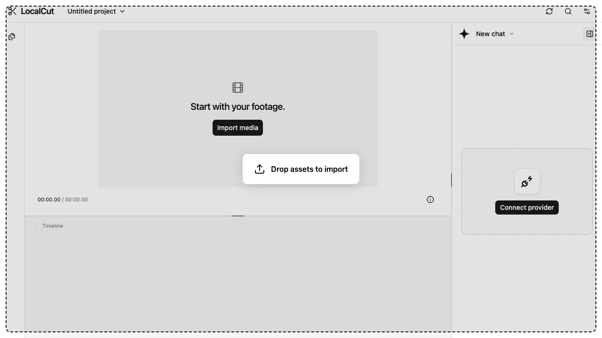
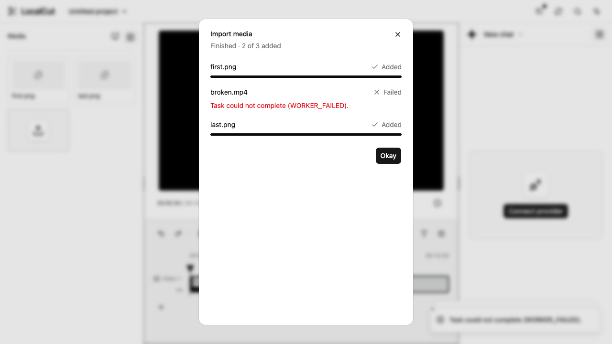
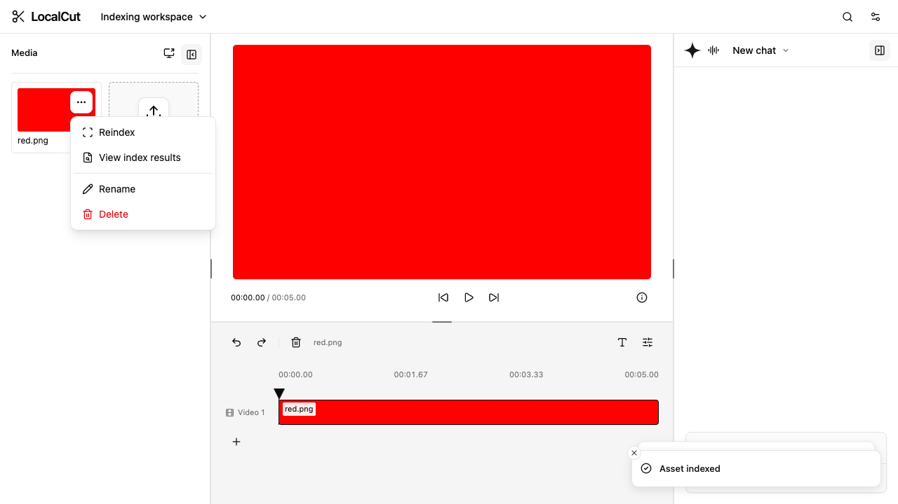
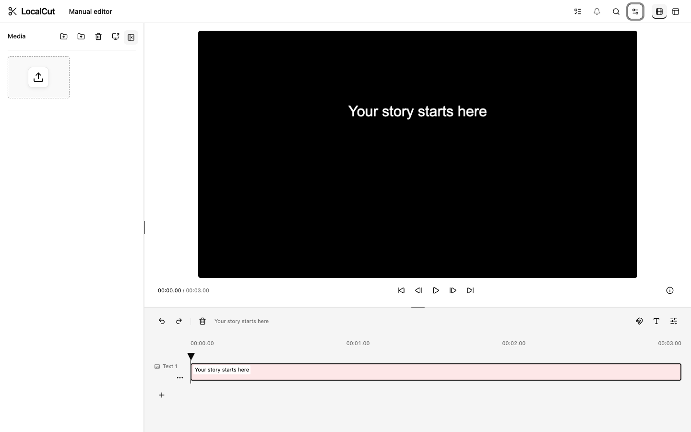
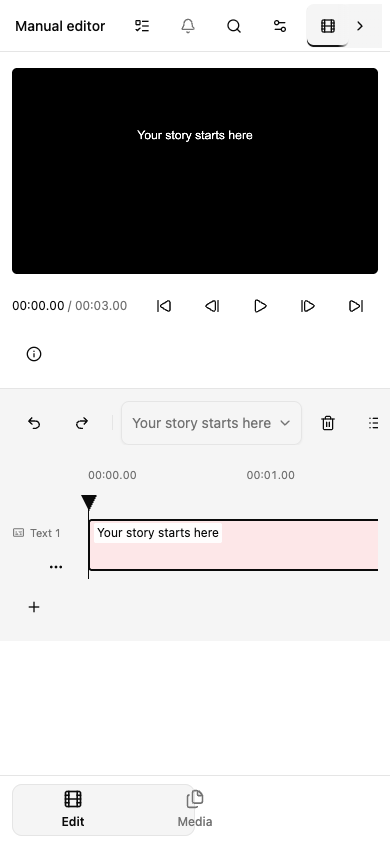

# Workspace

[WebMCP site tools](webmcp.md) let any compatible browser agent create/open projects, import browser-selected local files and control the viewed project through shared workspace/editor owners. The setup tool is available on an empty screen without initializing editing storage. Historical views remain read-only; navigation retires previous project tools and their jobs/artifacts. No built-in AI connection is required.

## Application updates

LocalCut has no in-app update check or update prompt. Use the browser's installed-app update controls or refresh the app. Recovery from a missing deployment asset still offers an explicit Reload LocalCut action that preserves the project URL and saved browser data.

## Project navigation

Select the project name in the desktop or mobile editor header to open the Projects dialog over the mounted editor; the name has no chevron. Escape, Close or selecting the Current project dismisses it without changing the URL or editing state. Selecting another project closes it and navigates to that project. The LocalCut logo is static branding. Settings → Project → Open project and Mod+O open the Projects screen. Editor and Storyboard tabs sit at the far right of the project header, after the global actions, with left-aligned contents. Search saved names, then select a project to open it in the editor. Projects are sorted by name and show clip count and timeline duration; the active project is marked Current. New project and Import backup reuse the existing flows. Workspace/project ZIP imports remain available through settings and Commands.

Back to editor or selecting the Current project preserves the current selection, playhead, version preview and conversation. Browsing pauses playback and hides the mounted editor from keyboard/accessibility interaction. Opening another project flushes the current project's pending version, resets selection/playhead and clears any previous video download. Project events refresh the list across windows; Refresh projects retries failed loads and picks up saved changes. Bare page navigation remains inert: project storage and editing services initialize after an explicit create/open/import or browse action, or a valid project/catalog route. This screen does not delete, rename or migrate projects.

The workspace shell and project browser render with the initial UI rather than waiting for a separate workspace chunk. A local display cache immediately supplies project names, clip counts and durations on return/reload; storage refresh replaces those summaries without clearing the list or its search. Cached rows remain usable during catalog refresh. Selecting one reads the current project from storage, so removed projects fail through the existing recovery flow instead of opening cached documents. Uncached lists, editor panels and project opening use themed skeletons that respect reduced motion. See the [workspace skeleton](screenshots/loading-workspace-skeleton.png), [cold project list](screenshots/loading-projects-skeleton.png) and [cached mobile list during refresh](screenshots/loading-cached-projects-mobile.png).

## Project creation

The New project dialog offers aspect-ratio and resolution presets, editable pixel dimensions and a frame-rate selector, defaulting to 1920 × 1080 at 30 fps. Resolution tiers use the shorter side (height for landscape, width for portrait). Only presets within the existing 3840-pixel width and 2160-pixel height limits appear. Manual dimensions show matching presets or Custom; fractional frame rates retain their exact rational values in the project. These settings belong to each project and survive reopening. Cancelling the dialog discards its unsaved choices. See the [desktop creation controls](screenshots/project-format.png) and [mobile dialog](screenshots/project-format-mobile.png).

## Local user preferences

Invalid or unknown preference records use safe defaults, with finite widths clamped to supported bounds. Blocked/full storage leaves controls usable for the session and reports a toast with a recovery step. A later successful change retries saving the session choices. Appearance Reset affects appearance only, preserving workspace preferences, projects and other applications' storage.

The audit covers the workspace, conversation/session picker, preview/timeline, dialogs, settings, appearance and shared UI controls:

## Appearance

Inspired by [shadcn Create](https://ui.shadcn.com/create), the panel offers light/dark/system mode, neutral base color, accent theme, body and heading fonts, radius, density, menu color and menu accent. Both font menus offer the complete text-editor catalog: 1,787 bundled families and ten legacy styles, alongside the eight additional named local stacks. Search font names and style/language tags to reach all choices; headings can also follow the body font. Selected bundled families load from the application origin with verified checksums, including all Unicode subsets for future interface text. Font files and the full catalog stay lazy on default startup; saved bundled choices restore without opening editing services. Loading failures retain the selection and offer Retry fonts. Base UI and Lucide remain fixed. Density changes preview/timeline spacing. Theme colors also adapt timeline clips while audio and text retain distinct semantic tints. Video content and exported media are unaffected.

Choices save automatically in this browser and synchronize across tabs on the same origin. They apply before the workspace renders; System follows the device color scheme. Randomize changes appearance options while retaining the chosen mode and interface size. Reset restores LocalCut's light, neutral, system-sans defaults and removes only its appearance record. If browser storage is blocked or full, changes remain usable for the current session and the panel reports that they could not be saved. Unsupported or malformed records fall back to safe defaults.

Interface size offers Default (100%), Small (75%) and Large (125%) with an immediate preview. It scales controls, menus and dialogs together, without changing project geometry or export resolution. The desktop timeline fills to the editor bottom; shorter viewports scroll inside the editor and narrow layouts show only the selected workspace tab at the selected size. Playback controls wrap when side panels leave a narrower preview. See the [Default](screenshots/interface-default.png), [Small](screenshots/interface-small.png) and [Large](screenshots/interface-large.png) desktop layouts. Older saved appearance and portable backups default to 100%. Size survives reload and tab synchronization; Randomize retains it and Reset returns it to Default. Page zoom shortcuts and gestures are intercepted, but a web page cannot reset or lock browser-menu or saved site zoom; use the browser's 100% setting for the nominal sizes.

Close the panel or press Escape to return focus to Workspace settings. An open picker handles Escape first. No account, editor initialization or remote request is needed to customize appearance.

## Projects and media

Creating or opening a project explicitly initializes the existing engine. Bare initial navigation without a saved recent project does not open IndexedDB, start workers, request permissions or download models. The Projects screen lists projects in this browser. React Router hash routes identify the current saved project as `#/project/<id>` and the project catalog as `#/projects`. The catalog URL includes `?project=<id>` when returning to the current editor is possible. Creating, opening or importing a project updates the URL. Reload or a direct project link restores that local project and its committed edits; Back/Forward selects the screen and project recorded in history. These routes work at both `/` and `/LocalCut/` without server rewrites. Project links refer to this browser's local storage, not shared cloud projects.

Import media accepts the supported video, audio and image formats described in the engine API. Each successful file import is appended to its matching track through an atomic command batch. Images begin with five seconds; video and audio use their measured source duration. Images/video are fitted inside the project dimensions without changing their aspect ratio. Files that fail validation do not create clips; files already committed earlier in the same selection remain available.

Drop local files anywhere over the app, including the Media tab. An app-wide indicator appears while files hover over an available workspace. Text, links and internal timeline drags retain their existing behavior. Busy operations, dialogs, unavailable project routes and historical versions reject file drops without navigating away. An explicit drop can create the first project; hovering does not initialize editing. On mobile, dropping reveals Media without changing desktop layout preferences.

Picker selections and drops share an import progress dialog with one row per file, measured job progress, and queued, importing, added, failed or cancelled results. Invalid files retain their error and do not stop the rest of the batch. All selected files are submitted to the durable task queue before waiting for results. Okay and the top-right X are the only buttons; either dismisses the informational dialog while imports continue, as does Escape. Dismissal permits editing and project navigation and keeps background completion from changing the current selection or panel visibility; files are still placed in selection order in the initiating project against fresh revisions. The dialog stays open after completion until dismissed; a new batch starts a new summary, and old background batches cannot overwrite it. Task queue retains per-task cancellation; cancelling one file does not cancel the other queued files. Original files remain local. Progress before measurement is indeterminate, and import progress describes inspection/storage rather than a remote upload.

The media panel arranges the independent local library left-to-right, top-to-bottom, followed by an outlined upload-icon shadcn Empty import card as the last grid item; its tinted surface, stronger dashed border and raised icon tile distinguish it from media thumbnails, and its whole surface opens the file chooser. The Media title, root/breadcrumb navigation, folder controls, speech and screen recording share one compact header with a single divider beneath it. Actions stay in one horizontally scrollable row when space is limited. Backup remains in Settings → Project → Download project backup. Each media card has a top-right actions menu revealed on hover or keyboard focus and always visible on touch devices. It contains Rename, Move to, Copy to, Delete, Download and Relink for missing sources. Library names and folder operations use the separate library revision. Delete moves library entries into recoverable Trash and preserves timeline clips, originals and saved index runs. See [Media folders](#media-folders) for navigation and recovery. Browsed versions disable edits. Settings → Project → Export project and Import project provide a scoped transfer dialog with optional saved versions and individual original-asset checkboxes. Workspace Export/Import uses the same flow for all saved projects, including closed projects, plus separate appearance and workspace preference groups. Select or clear projects, versions and originals independently. Project import chooses one project when inspecting a multi-project archive. Exports without source files are JSON; selecting originals produces ZIP. Missing or omitted originals require relinking. The dialog previews contents before importing new copies and leaves the active editing session intact.

Legacy Download project backup / Import project backup controls retain the original JSON-only format; version-one project envelopes also work in the new project import dialog. Archives exclude keys, sharing consent, conversations, receipts, undo/redo, caches and unrelated origin storage. Import never reconnects AI or starts paid requests. Complete settings groups replace only their corresponding saved preferences. Settings-only import keeps editing services inert. Imported projects commit together; settings persistence failures retain those copies, report an error and permit a settings-only retry. Cancellation is available while reading/packing/restoring; published copies survive late cancellation. The [storage contract](storage.md#workspace-and-project-transfer) describes validation and resource limits.

### Asset viewing

Click a Media asset thumbnail or name to view the original image or play its video/audio with native controls. Enter and Space open the focused card. Escape or Close returns focus to the card and stops playback; temporary preview URLs are released. Viewing pauses timeline playback and leaves the project unchanged, including historical versions. Missing or unsupported sources show recovery guidance. Modifier-click selection and thumbnail dragging retain their existing behavior.

### Screen recording

Use **Media → Record screen → Choose source and record** to create media from a screen, app window or browser tab offered by the browser's sharing picker. Capture requires a supported desktop browser on HTTPS or localhost and explicit permission for each recording. App capture uses the selected app window; available surfaces and system permission prompts depend on the browser and OS. Opening the dialog alone requests no permission and starts no editing services.

**Include shared audio** is off initially. Enable it before choosing the source, then enable the picker's audio option where offered. LocalCut requests system audio for screen and window capture, but the browser and OS decide whether to supply it. If no live audio track is returned, recording does not start: the dialog explains how to retry, or you can turn the option off for video-only capture. If shared audio ends during recording, LocalCut stops immediately and preserves the recorded portion for review; the dialog explains why it stopped. This also preserves the take when a browser ends audio before video after Stop sharing or source closure. The live preview stays muted to prevent feedback; this does not mute the recorded sound. When shared audio is enabled, the dialog shows browser-specific guidance before source selection. Safari and Firefox do not provide shared tab/system audio through this API: turn off shared audio for a silent recording, or open both LocalCut and the target page in Chrome or Edge and share that browser tab with audio enabled. Chromium browsers recommend tab audio and explain that screen/window sound depends on the browser and OS; unrecognized browsers receive cautious support and fallback guidance. Browser identification selects helper text only; actual returned tracks still determine whether recording can start. Newer Chrome versions can also offer system audio for screens/windows where supported; check macOS Screen & System Audio Recording permissions if access is denied. LocalCut cannot add audio that the browser did not capture. Microphone capture is not requested. Use **Stop recording**, or the browser's Stop sharing control, to finish and review the playable recording. **Add to media** imports it through the ordinary local Media import workflow, creating an untitled project if needed. **Save a copy** downloads the recording before import or after an import failure. Imported recordings support editing, history, persistence and export like other video sources.

Discard, Escape, close and project navigation release capture and discard unfinished media, including permission granted after dismissal. No capture is requested on startup, no permission is remembered by LocalCut, and recordings are never uploaded. Recording is unavailable in historical versions. Capture metadata and completed recordings are retained in the task sidecar; cancelled captures retain only their status. Capture never initializes project storage before Add to timeline. Buffers remain transient until the queue saves a completed take: capture stops automatically at 30 minutes or near 256 MiB; exceeding that byte cap fails explicitly. Long recordings should be split into separate takes. Source dimensions are retained; timeline fitting uses the existing project settings. See the [live desktop preview](images/screen-recording-live.png) and [narrow review dialog](images/screen-recording-narrow.png).

## Editing and preview

Select a timeline clip to open its properties, split at the playhead or delete it. Start and duration use seconds in the form and integer microseconds in the engine. Changing only speed preserves the existing source range and changes duration. Clip properties offers Change pitch/Keep pitch and a Speed profile selector. Choose a constant rate or up/down/up-then-down/down-then-up preset; edit point percentages and rates, add/remove interior points, and choose Curve, Linear or Staircase for each segment. Dedicated staircase presets start with eight editable plateaus and reach their last speed before the endpoint. The graph shows the current profile. Editing duration explicitly changes the source out-point; the engine rejects unavailable source time and invalid keyframe/caption/fade bounds. Undo and Redo use the canonical history and revision checks, including after reload.

Manual changes retain the revision shown in the workspace. If another window commits first, LocalCut rejects the stale change and refreshes the form. Review the latest values before retrying; concurrent edits are not silently overwritten.

See the [text library](images/text-library.png) and [narrow text library](images/text-library-narrow.png). Gallery samples, preview and export share the same text drawing function.

Preview uses the same engine compositor as export, at a maximum 960-pixel preview dimension during both paused viewing and playback. Export retains the authored resolution. Playback prepares a bounded frame buffer and keeps presentation synchronized with its audio clock. The playhead and timecode update independently of the wider workspace; editing commands read the current clock position when invoked. First-frame and last-frame buttons flank previous-frame, Play/Pause and next-frame controls in one row. They pause playback and seek through the same preview owner. Preview frame controls round their positions to integer microseconds, including the final-frame clamp at rational frame rates, so Play can resume after stepping. Playback creates its audio context only from the Play action. Scrubbing supersedes pending frames; project changes stop the old playback session. Disposal releases image bitmaps, sessions, audio contexts and active jobs. No media is sent to a server.

In Media, Cmd+A / Ctrl+A selects all visible assets in the current folder. Click selects one asset; Cmd-click / Ctrl-click toggles individual assets; Escape clears the selection. Moving to another folder clears media selection. Text fields retain native select-all, and the focused timeline retains clip select-all.

Seek by dragging the top marker of the playhead with a mouse or touch. Its padded target sits above the tracks so clip selection remains available. The timeline has no separate bottom scrub bar. Focus the marker to use the shared playback shortcuts, including frame steps and Home/End. See the [mobile](images/timeline-playhead-mobile.png) and [desktop](images/timeline-playhead-desktop.png) layouts.

Drag a ready media card onto an audio track for audio, or a video track for images/video. A compact thumbnail or media icon with the asset name follows eight viewport pixels from the cursor throughout the app while dragging, flipping to the other side near viewport edges. A dashed clip placeholder also shows the name, start time and full duration over a compatible track; moving off the lane clears only that placement placeholder. Release or cancellation clears the cursor preview. Dropping inserts another clip from the same local source through the shared engine, preserving existing clips and Undo/Redo. Images use the same five-second default as import. The timeline retains its time scale while hovering; long placeholders extend into horizontal scrolling. Missing sources, busy operations and historical versions cannot be dropped.

Drag a timeline clip to reposition it within its track or onto another compatible, unlocked track. A dashed placeholder shows the destination before release. The grabbed point stays under the pointer at different zoom and interface sizes. Snapping aligns either clip edge to nearby boundaries; its enabled/disabled icons differ. Group members move by the same time offset, with the grabbed member changing tracks. Click selection and end resizing stay separate; Escape, pointer cancellation or a project/version change cancels movement. Placement uses the shared revision-aware command/history path and persists locally. See the [desktop](images/timeline-clip-move-desktop.png) and [mobile](images/timeline-clip-move-mobile.png) placement previews.

Drag a track label to reorder the whole row. Its label and clips follow the pointer while neighboring tracks animate around the dashed destination placeholder. Release commits the order; Escape or pointer cancellation restores it. Reduced motion removes the rearrangement animation. Alt+Up/Down retains keyboard reordering.

Drag the right edge of a clip to shorten or extend its duration. The temporary edge and duration label preview the edit; release saves it and Escape cancels. Images and text keep their authored content for the new duration. Audio/video retain their selected source range and repeat from its beginning when extended beyond that range; dashed boundaries and a repeat icon identify loop-backs. The same loops play in preview and exports. Focus the edge to adjust by one frame with Left/Right, or ten frames with Shift. Undo/Redo, splitting, speed changes and local project reloads retain looping.

See the [media drop preview](images/timeline-media-drag.png), [track reorder preview](images/timeline-track-reorder.png) and [clip loop markers](images/timeline-clip-loop.png).

## Keyboard editing

Focus the preview or timeline to use single-key shortcuts. `Space` toggles playback; `K` pauses and `L` plays forward. Left/right arrows step one frame, Shift+left/right step ten frames, up/down visit previous/next edit boundaries, and Home/End seek to the first/last frame.

Zoom and pan are transient views, independent between timeline and preview; they never change project geometry or exports. Keyboard zoom targets the focused view, falling back to the timeline when the editing area has focus. Timeline zoom ranges from fit to 32×; preview from fit to 8×. Normal wheel/trackpad scrolling remains native; page-delivered Ctrl/Command zoom shortcuts and wheel/pinch gestures are intercepted throughout the app. Timeline/preview view zoom remains independent; browser-menu zoom and OS accessibility controls retain their own authority. `?` and Workspace settings → Keyboard shortcuts list the complete map. These mappings follow common [desktop editing conventions](https://helpx.adobe.com/sg/premiere/desktop/get-started/keyboard-shortcuts/default-keyboard-shortcuts.html), adapted to the supported LocalCut commands.

The local clipboard holds a frozen clip selection only within the current session and project, including group membership, keyframes, captions and transitions between copied clips. Paste makes new identities, keeps relative track/time placement and uses current originals; it does not access the system clipboard. Cut changes the clipboard only after its removal succeeds. Source files and text-field copy/paste retain their existing workflows.

Nudging preserves group offsets and clamps the earliest member at zero. Q/W shorten one ungrouped clip with the engine's split semantics, preserving animation, fades and source bounds; select a point inside the clip. Ripple delete closes the selected time interval on every track only when no retained clip intersects it and no retained group straddles it. Unsafe ripple/trim commands are unavailable. Engine validation still rejects invalid transitions or timing atomically. Normal Delete leaves the gap. All edits are undoable and preserve revision conflict handling. Holding an editing key does not repeat mutations; frame navigation and zoom may repeat.

The pass covers existing LocalCut workflows. Source-monitor insert/overwrite, markers, dedicated slip/slide/roll tools and reverse/rate shuttle have no supported workflow/API and receive no misleading bindings. Historical versions allow selection, navigation, properties and view gestures; mutation and clipboard shortcuts remain unavailable.

Dialog opening shows cancellable feedback immediately while optional UI code loads, then a modal loading shell and the requested controls. Escape or Cancel dismisses opening feedback; close/Escape also dismisses a loading shell. Completing a dismissed download never reopens it. Loaded dialogs reuse their code on reopening and retain normal focus return and reduced-motion behavior. Simple forms do not load the text library or clip-properties editor. Commands downloads its metadata and palette together and shows command controls only when both are ready.

See the [desktop palette](images/workspace-commands.png) and [narrow palette](images/workspace-commands-narrow.png).

Command on macOS or Ctrl elsewhere works with `Z` for Undo, Shift+`Z` for Redo, `O` for Open project, `I` for Import media, and `E` for Export. Ctrl+`Y` also redoes. Shortcuts never intercept text inputs, IME composition, dialogs or menus; Space on a focused button retains its native action. Editing shortcuts call the same revision-aware operations as the visible controls.

Pointer seeking snaps to the nearest clip start/end across every track, including audio, text/captions and overlapping clips, within eight screen pixels. Project edges also attract the playhead; the final position remains inside the half-open playback range. The magnet button in the timeline toolbar toggles **Snapping**, starts on and remembers the choice locally, across tabs and in workspace backups. Older settings/backups default on. Zoom, scroll and interface size preserve the screen-distance threshold. Keyboard frame stepping and playback retain their existing precision.

## Version browsing

The workspace omits unavailable editing, media and playback buttons; Versions and video export live in Settings → Project → Versions and Settings → Export → Export video, respectively, with unavailable actions omitted; the header omits their standalone buttons, the duplicate New project button and local-storage information icon. Create projects through the Projects screen, Workspace settings → Project → New project or Commands. Scrollbars are hidden throughout the workspace and popup surfaces; wheel, touch, trackpad and keyboard scrolling remain available.

Return to current resumes the latest project, including changes from another tab. Restore as new version copies the selected state into a new current revision and appends a new version; earlier and later historical entries stay unchanged. If another tab changes the current revision before restoration, review its latest state and retry. Undo can reverse the restoration without deleting the restored version. Closing history returns to the current project.

Autosave appends a version one second after the last committed edit. Rapid edits form one settled version; Undo/Redo also autosave. Pending work is checkpointed when switching projects, browsing history or closing the editor. A forced tab close still retains committed edits; reopening checkpoints the recovered current state. Version history is local to this browser and project; legacy project JSON carries current state only. The new workspace/project transfer dialog can include the version list and historical originals.

## Export

Export checks the exact requested MP4/H.264/AAC or WebM/VP9/Opus configuration. Unsupported codecs show an actionable error without changing formats or dropping audio. The engine captures the project revision, streams to local temporary storage and reports real progress. Cancel stops unfinished work; a completed artifact provides Save video. Closing the dialog disposes its temporary artifact without altering the project or an already saved download.

Safari can return an MPEG-4 ES descriptor instead of the raw AAC AudioSpecificConfig. LocalCut extracts the decoder configuration for both priming calibration and exported packet metadata, preserving audio and its measured timing. This corrects the reproduced `InternalAudioDecoderCocoa decoding failed` path; Chrome remains the primary full acceptance target.

## Verification and limits

Version browsing adds compatible fields to existing project records without an IndexedDB version upgrade. See [storage compatibility and rollback](storage.md) before using older application writers; they retain the current project but do not preserve its version history. Deployment uses the automatic Pages workflow on pushes to `main` in [DEPLOY.md](../DEPLOY.md).

## App icons and installation metadata

## Timeline selections and templates

Use the **+** beneath the final timeline track, then choose the inline audio or video icon to create a separate empty track, including before importing media. Each addition is saved locally and supports Undo/Redo. Empty tracks remain visible. This control is hidden during operations and while browsing historical versions. Drag a track label vertically to reorder layers, or focus it and press Alt+Up/Down. Ordering uses the shared persisted command and supports Undo/Redo; historical versions cannot be reordered. Uploads only add assets to Media; drag an asset onto a compatible track to place it explicitly.

Visual timeline clips show a local thumbnail repeated across their width, sampled at the trimmed source start for video. Audio clips, including audio separated from video, show locally decoded peak waveforms mapped to the clip's trimmed range and speed curve. Names remain readable over the previews and buttons retain selection, focus and touch behavior. Only visible clips request previews, with at most two jobs running and shared audio analysis for the same asset. Clip and timeline resizing refresh visibility observations so import-driven layout changes cannot leave an onscreen cached preview unloaded. Leaving the viewport or closing the timeline cancels unused jobs and releases object URLs; missing or undecodable assets retain their filename without a preview. These previews do not upload media or run AI indexing.

Shift/Mod-click adds or removes clips from the selection. Clicking a grouped member selects its entire group; the group underline keeps membership visible. Use Group/Ungroup in the timeline or command palette, or Mod+G / Mod+Shift+G. Delete and Duplicate act on the selection. Changing a grouped member's Start in Clip properties moves the group by the same offset; duration, speed and gain remain individual property edits. Negative placement or broken transition overlap rejects the whole edit. Ungroup before moving a member independently.

Select an unmuted video clip with an audio stream to reveal Separate audio. The result is a separate audio clip on an audio track referencing the original file; the video is muted to prevent doubled sound. Group the two clips if they should move together. Undo restores the combined clip.

## Mobile workspace

The timeline scrolls horizontally independently of the page and preserves proportional zoom at narrow widths. Closing media leaves timeline zoom and editor shortcuts available. The mobile clip picker shares the horizontal timeline toolbar with Undo/Redo and reaches even short or overlapping clips. Extra contextual tools scroll horizontally in that row; see the [mobile toolbar](images/mobile-inline-toolbar.png). Press and hold a tool for 500 ms to show its tooltip (or accessible label) without activating it; ordinary taps still run the action. Moving, scrolling or cancelling the touch dismisses help. Help also works on dialog, popup and drawing tools, and closes after release, another touch or Escape. Enable **Select multiple clips**, then choose clips through the picker or timeline to group or ungroup them using the existing controls. The mode resets when resizing to a layout that hides its touch controls, preserving ordinary desktop selection and modifier behavior. Touch controls, popup items and inputs use comfortable sizes; dialogs scroll in short viewports, safe-area padding protects edge controls, and reduced motion is honored. Desktop editing and shortcuts retain their existing behavior.

## Project cards and actions

Projects shows a responsive card list with Active and Archived controls beside the page title. Open a card to resume editing, or use its actions menu to Rename, Adjust thumbnail, Export backup, or Archive/Restore. Rename is undoable. Thumbnail adjustment accepts a local PNG, JPEG or WebP image and horizontal/vertical framing; Use automatic thumbnail resets to a frame from the first image/video clip (or a film placeholder when no source is available). Archive preserves edits, versions and originals and remains reversible in Archived. The current project remains open and identifiable while archived. Custom covers and archive organization stay in this browser and are excluded from exported editing backups.

## Track menu

Each track has a compact ellipsis menu beneath its name. Rename, enable/disable, mute/unmute, solo/unsolo, lock/unlock, duplicate, move up/down, clear clips and delete use shared engine commands. Overlay tracks omit audio mute; first/last layers omit unavailable move directions. Locked tracks omit move/clear/delete and hide selected clip edit actions while retaining inspection. State icons show disabled, muted, solo and locked tracks; custom names remain discoverable in tooltips and accessible labels.

Rename and populated-track clear/delete use revision-bound dialogs; external edits invalidate an open form instead of overwriting newer state. Empty-track delete is immediate and undoable. Historical versions expose no track mutation menu. Menus support keyboard and touch, constrain scrolling to the popup and remain within mobile viewport bounds. Drag and Alt+Up/Down reordering remain available for unlocked tracks. All operations retain persistence and Undo/Redo.

## Object keyframe animation

Open a selected clip’s **Clip properties → Animation**. Choose a property (position, dimensions, rotation, opacity, image/video effects, or audio gain), then add points at the playhead, clip start or clip end. Times are seconds relative to this clip’s start. Edit each point’s time, value and Linear/Hold interpolation; interpolation controls the segment leading to the next point. The graph shows the curve and current playhead. Base value applies when the property has no points; Gain uses the existing Gain field. Clear property animation or remove individual points to return to the base value.

Apply properties commits the complete edit through the shared engine. Cancel discards the draft. Points must have distinct times inside the clip and valid property values; incomplete or invalid numeric drafts remain blocked across property switches and publish nothing. Return to the named property to correct the field or remove its point. Draft curves are applied before speed and resize commands, so edited and untouched curves follow the engine’s existing rescaling or trimming behavior. Final point times must fit the resulting duration; constant speed changes without a ramp retain clip-local point times. Read-only versions and locked tracks allow inspection only.

Animation belongs to the selected timeline instance. Other placements of the same asset, original media bytes and earlier snapshots remain unchanged. Duplicate, split and paste create independent instance/keyframe identities. Undo/redo, versions and backups retain these existing clip-local curves; no schema or storage migration is required.

### Compact workspace controls

## Editor and Storyboard

The Storyboard menu provides Upload image and Insert image from Media, including source-relative video stills. Both use the shared editor image insertion path; images persist locally, share project history, and appear in all board export formats. See [image workflows](storyboard-workflows.md#insert-pictures).

Drawings save through revision-aware project commands. While the whiteboard module loads, a theme-aware canvas and toolbar skeleton replaces the plain loading message; it supports narrow layouts, reduced motion and screen-reader status. Icon-only Undo/Redo live in Excalidraw's main drawing toolbar, without a separate Storyboard heading. They use shared project history, so they can also undo an earlier timeline edit. Canvas drawing shortcuts stay inside the diagram. Historical project versions display their storyboard in read-only mode. Project/workspace backups include diagrams. Images use local Media snapshots; web embeds remain unavailable. No Excalidraw account, collaboration or cloud save is used.

The canvas menu offers Export PNG, Export SVG, Export editable scene and Store PNG in Media. Choose the whole board or selected elements, background/transparency and 1×/2×/4× output. These actions flush pending drawings and use the shared revision-bound editor exporter. Storing publishes an immutable PNG in the project's Media root for later placement, cropping, animation and blending; it does not alter the diagram or insert a clip. Exports use local fonts and pixels and stay local until the user downloads/shares them. Historical views retain their read-only controls. See [storyboard workflows](storyboard-workflows.md) for options, recipes and editable interchange limits.

See the [desktop storyboard](images/workspace-storyboard.png) and [mobile storyboard](images/workspace-storyboard-narrow.png), plus cold-loading views in [light](images/whiteboard-loading-light.png), [dark](images/whiteboard-loading-dark.png) and [mobile](images/whiteboard-loading-mobile.png) layouts from the production Chrome regressions.

## Color, audio, blending and masks

Open a clip's properties to expand Color, Audio, Blending, Mask or Chroma key. Color offers built-in looks, local `.cube` import/removal and combined grade strength. Audio offers mute, balance, fades, three-band EQ, spectral noise reduction and its noise floor. Blending chooses how that clip combines with lower tracks; opacity stays in existing object animation. Mask geometry is relative to the clip; inversion and feathering adjust its matte. Chroma key includes color, tolerance, softness and spill suppression. Audio clips omit visual groups.

Track mask computes local video translation from the draft region and stages editable motion points. Progress and Cancel tracking stay available; closing the form cancels work. Apply properties commits the draft through the existing revision check. Tracking failure retains the draft and reports the needed correction. Clear mask motion restores a static region. Tracking requires textured content and limited motion; see [the API limits](api.md#creative-effects-and-local-mask-tracking). All these settings survive history, reload and backups, and preview/export share the same rendering/mixing owners.

## Media folders

Every project owns a distinct browser-private filesystem root keyed by project ID. Switching projects resets folder navigation and dialogs; in-flight uploads retain their initiating project. Project rename keeps its root. See [migration and recovery](storage.md#shared-library-migration) for existing shared-library data.

Folders appear before files, with natural filename ordering. Import completion order does not rearrange the library. Pending directory traversal is discarded if its initiating project changes or the workspace unmounts.

Media shows the browser-local library independently of timeline clips. Inside folders or Trash, a separate breadcrumb subheader below the Media toolbar shows the current path. Its Media text button returns to the root, ancestor buttons navigate directories, and the current location is marked. The root has no breadcrumb row. Long paths scroll horizontally within the panel; on mobile, both header rows stay reachable as media scrolls. New folder and Upload folder remain in the main action row. Import media uploads into the current folder. Folder selection preserves relative paths; the browser's HTML folder picker does not expose empty directories. Directory drops preserve empty folders and drain every directory-reader batch. File/folder drops target the hovered folder or current Media directory; drops elsewhere import at the root.

Drag a media thumbnail onto a folder or breadcrumb to move that library entry. Dragging onto the timeline retains its existing insertion behavior. Context menus provide Rename, Move to, Copy to, Delete and Download; folders download as ZIPs. Keyboard users can use the same menus and destination controls. Trash exposes Restore. Deletion preserves current timeline clips, immutable editing originals and saved versions; use Restore to recover organization. Historical version browsing retains its read-only media view.

Library filenames are independent of immutable-source display labels. Folder changes persist in this browser/origin and synchronize between tabs. Project/workspace backups retain original media but do not include the folder layout; use folder Download when that hierarchy must be exported. Library copies and temporary moves use additional origin storage; quota or missing-file failures leave edits accessible and expose Retry media.

Uploaded files and folders stay in the project Media library without adding timeline tracks/clips or changing the timeline revision, selection or Undo history. Folder imports report macOS `.DS_Store`/AppleDouble and Apple Photos `.AAE` metadata as Skipped; these files are not playable media and do not start decoder tasks. Other unsupported/corrupt files fail individually while valid siblings keep their hierarchy.

## Clip properties tabs and instance actions

Clip properties opens on General for start, duration, speed, gain and timed-source pitch/speed profiles. Color, Blending, Mask, Chroma key, Audio, Animation and Text appear as appropriate tabs for the clip. Switching tabs retains unsaved fields, curves and effect drafts; Apply properties saves them together through the existing revision-aware commands. Invalid native fields reveal their tab and receive focus. Cancel discards drafts. See [the tabbed properties dialog](images/clip-properties-tabs.png). Locked tracks and historical versions remain read-only.

Right-click a timeline clip, press and hold for 500 ms, or focus it and press Shift+F10/the Context Menu key to open Clip actions. Properties opens the clicked instance, Select clip uses the existing selection behavior, and Split at playhead/Delete clip act on that instance alone, regardless of another selection. Split is available only inside the clip's interval. Opening a menu does not select or edit. Mutation actions respect busy, locked, historical and stale revisions; reopen after another edit. Moving/cancelling a touch cancels the hold, and releasing a hold does not move the clip or activate a menu item. Escape/outside interaction dismisses the menu and returns focus to its clip. See [the touch clip action menu](images/timeline-clip-menu-touch.png).

## Editor layout after agent removal

The desktop editor uses the space beside the independently collapsible Media library. Media width and timeline height remain resizable and persistent. Mobile navigation offers Edit and Media, with keyboard focus recovery on transitions. There is no chat panel or provider settings entry. Media cards retain metadata tooltips and their ordinary actions.

